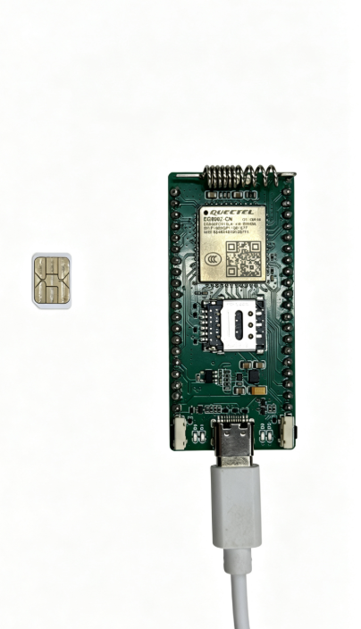
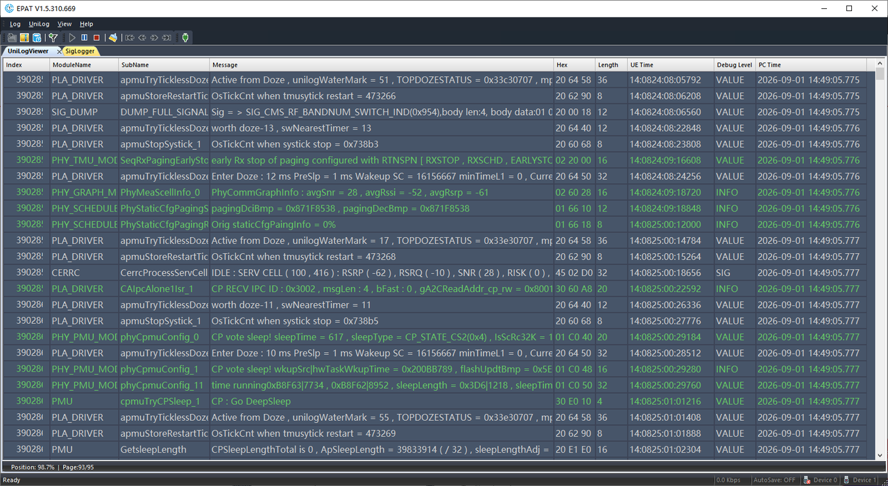
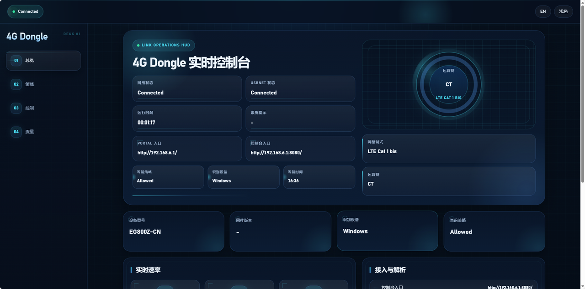
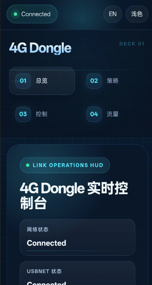

# 4G USB上网卡

[English](README.md)

4G USB上网卡方案是一个基于UniRTOS构建的USB共享上网与本地Portal管理方案。

本项目以UniRTOS作为端侧运行基础，结合网络附着、PDP配置、Datacall建立、USBNET共享、子网配置与NAT转发机制，在移远通信模组上实现蜂窝网络共享和本地页面管理。Windows、Linux及兼容的Android终端通过USB连接模组后，可将设备识别为虚拟网卡，使用模组的蜂窝数据连接访问互联网，并通过浏览器打开内置管理页面。

Portal可展示设备型号、固件版本、网络状态、运营商、USBNET状态、运行时间、上下行速率，以及今日、本周、本月流量统计，并提供连接、断开、重启设备和RNDIS/ECM协议切换等控制操作。本项目可作为4G USB上网卡、USB网络共享设备和嵌入式本地管理页面的参考示例。

# 开发资源

| 资源名称 | 数量 | 简要描述 | 获取方法 |
| :--- | :--- | :--- | :--- |
| pico开发板 | 1 | 项目运行硬件平台，需使用所选UniRTOS固件支持的开发板和模组。 | 自行准备 |
| USB数据线 | 1 | 支持数据传输的USB-A转USB-C数据线，非“仅充电”类型。 | 自行准备 |
| PC | 1 | Windows 10/Windows 11，用于开发和固件烧录。 | 自行准备 |
| SIM卡 | 1 | 已开通数据业务、可正常上网的USIM卡。 | 自行准备 |
| Ubuntu设备 | 1 | 可选，用于Linux平台USB共享上网验证。 | 自行准备 |
| Android设备及OTG转接线 | 1套 | 可选，设备需支持USB Host/OTG及所选USB以太网协议。 | 自行准备 |

# 快速上手

## 硬件连接



1. 将SIM卡插入开发板的SIM卡槽。
2. 按开发板说明确认蜂窝天线已正确连接。
3. 使用USB数据线连接开发板和PC。

进行Android平台验证时，需使用适配的OTG转接线连接，并确保开发板供电充足。

## 软件部署

### 开发环境搭建

参考[UniRTOS快速入门](https://docs.quectel.com/zh/UniRTOS/UniRTOS文档/快速上手/快速上手.html)完成开发环境安装，并确认`unirtos-cli`可在PowerShell中使用。

### 代码拉取

新开启PowerShell窗口，执行以下命令：

```powershell
unirtos-cli new -r unirtos-maker-examples
cd unirtos-maker-examples
```

在下载的仓库中找到USBNET Demo，进入同时包含[CMakeLists.txt](CMakeLists.txt)和[usb_net.c](usb_net.c)的工程目录。后续命令均在该目录下执行。

### 修改配置参数

应用配置集中在[usb_net.c](usb_net.c)，构建模组与SDK版本配置位于[env_config.json](env_config.json)。

| 配置类别 | 配置项 | 说明 |
| :--- | :--- | :--- |
| 蜂窝APN | `USBNET_DEMO_DEFAULT_APN` | 默认为空，使用运营商或默认APN配置；若运营商有特殊要求，填写其提供的APN。 |
| SIM与PDP配置 | `qosa_usbnet_demo_task()`中的`simid`、`profile_idx` | 默认SIM ID为`0`，PDP Profile为`1`。 |
| 共享方式 | `qosa_usbnet_demo_task()`中的`method` | 默认为`QOSA_USBNET_METHOD_ONE_SHOT`。 |
| USB协议 | RNDIS / ECM | 启动时保留受支持的当前协议，可通过Portal或协议切换按键切换；切换后设备会重启。 |
| 协议切换按键 | `USBNET_DEMO_BUTTON_PIN` | 默认为`QOSA_PIN_82`，使用前需核对开发板引脚映射和按键接线。 |
| 本地子网 | `USBNET_DEMO_PORTAL_IP_TEXT`、`USBNET_DEMO_USB_HOST_IP_TEXT` | 默认模组地址为`192.168.6.1`，USB主机地址为`192.168.6.100`，子网掩码为`255.255.255.0`；修改时需同步维护相关地址字符串及地址字节数组。 |
| 子网配置开关 | `USBNET_DEMO_FORCE_APP_SUBNET` | 默认为`1`，启用应用侧子网配置。 |
| HTTP端口 | `USBNET_DEMO_CAPTIVE_PORT`、`USBNET_DEMO_PORTAL_PORT` | 分别为`80`和`8080`。 |
| 状态采样 | `USBNET_DEMO_STATUS_POLL_INTERVAL_MS`、`USBNET_DEMO_STATUS_HEAVY_POLL_CYCLES` | 默认每`1000 ms`采样一次，每`5`个周期执行一次全量状态采集。 |
| 应用层DNS | `USBNET_DEMO_USE_APP_DNS_TASK` | 默认为`0`，不启动应用层DNS任务，保留SDK的DHCP/DNS relay路径。 |
| 构建环境 | `build.module`、`sdk.version` | 当前分别为`EG800ZCN_LA`和SDK `1.0.5`，按实际模组和环境调整。 |

### 构建项目

在PowerShell中执行环境配置命令：

```powershell
unirtos-cli env-setup
```

使用所提供示例中的模组型号和固件版本执行构建：

```powershell
unirtos-cli build -m EG800ZCN_LA -v EG800ZCN_LA_BETA_20260904
```

若实际模组或SDK环境与示例不同，请将模组型号和固件版本替换为对应环境中可用的值。

构建成功后，命令行末尾将显示：

```text
SUCCESS: Unirtos project built successfully!
```

通过QFlash工具将生成的固件烧录至开发板。

### 验证项目

1. 长按开发板电源键（`PWKY`）开机，打开EPAT工具，根据[日志调试教程](https://www.quectel.com.cn/unirtos/docs?docs_page=快速上手/日志调试/日志调试.html)完成配置，再重启开发板，从模组上电开始抓取完整日志。

	

2. 等待网络附着、Datacall建立和USBNET启动。可重点关注`usbnet wait attached success`、`usbnet start`、`portal task create ok`等日志。
3. 确认终端识别到USB虚拟网卡，并获取本地网段IP地址。
4. 在浏览器中访问`http://192.168.6.1/`，也可访问`http://192.168.6.1:8080/`。若子网配置不同，以终端和模组日志显示的实际USB网关地址为准。
5. 在Portal中查看设备信息、连接状态、速率和流量统计。访问`/status`可获取JSON格式的动态状态数据。
6. 临时关闭测试终端的其他网络接口，通过访问外部网站验证蜂窝共享上网，验证后恢复原有接口。仅能打开Portal，说明本地管理页面可达，不代表外网已经连通。

## 跨平台验证

### Windows平台

1. 使用RNDIS模式，将开发板连接PC。
2. 打开**设备管理器 > 网络适配器**，确认出现类似**Remote NDIS based Internet Sharing Device**的设备，实际名称可能随驱动不同而变化。
3. 在命令提示符中执行`ipconfig`，检查USB网卡的IP地址和默认网关。
4. 按上述步骤验证外网访问，并通过浏览器打开Portal。



### Linux（Ubuntu）平台

1. 如需使用ECM模式，通过连接PIN82的协议切换按键或Portal控制项切换，等待模组重启和USB网卡重新枚举。
2. 执行`ip addr`或`ifconfig`，确认新增网卡及其IP地址。网卡可能命名为`usb1`、`usb0`或`enx...`，以实际系统为准。
3. 执行`ping www.baidu.com`检查网络连通性，再通过浏览器访问Portal。若网络限制ICMP，可改为访问外部网站进行验证。

### Android平台

1. 根据手机要求开启OTG功能，连接开发板并供电。
2. 选择手机支持的USB以太网协议。兼容性取决于Android设备、内核和USB以太网驱动，仅支持OTG不代表一定支持本方案。
3. 确认系统识别到以太网连接，再验证外网访问并通过浏览器打开Portal。连接状态图标因设备而异。



# 软件设计

| 模块 | 入口或关键函数 | 主要职责 |
| :--- | :--- | :--- |
| 应用初始化 | `unir_usbnet_demo_init()`、`UNIRTOS_APP_EXPORT()` | 注册应用入口并创建主任务。 |
| 主任务 | `qosa_usbnet_demo_task()` | 初始化协议、等待网络附着、配置PDP/子网/NAT、建立Datacall，并启动USBNET及各服务任务。 |
| 连接控制 | `_usbnet_demo_connect_data()` | 处理连接请求，建立蜂窝数据出口并启动USB共享。 |
| 状态采集 | `qosa_usbnet_status_task()` | 结合低频全量采集和高频轻量更新，将结果保存到统一缓存。 |
| Portal服务 | `qosa_usbnet_portal_task()`、`_usbnet_demo_handle_portal_client()` | 提供内置HTML/CSS/JavaScript页面并处理HTTP请求。 |
| 状态接口 | `_usbnet_demo_build_status_json()` | 将缓存状态序列化为`/status`接口的JSON数据。 |
| 动作处理 | `_usbnet_demo_process_pending_action()` | 在主任务中执行排队的连接、断开、重启和协议切换操作。 |
| 异步回调 | `_usbnet_demo_func_cb()` | 记录USBNET操作结果并回收配置上下文。 |

Portal页面嵌入C应用中，无需单独构建前端工程。HTTP处理流程将控制动作排队，由主任务串行执行，使页面请求处理与耗时链路操作分离。

# 注意事项

- 网络策略支持网络访问开关、时间计划、总流量限制及Windows/Linux设备策略等配置和状态回显，但`_usbnet_demo_enforce_policy()`尚未实现硬阻断，不能作为实际接入控制或计费依据。
- 今日、本周、本月流量由Datacall累计计数和运行期基线推导，属于演示统计，不是持久化计费记录；统计周期的准确性依赖有效的设备时间。
- 重启和协议切换会中断USB网络连接，需等待网卡重新枚举后再访问Portal；断开USBNET也可能导致页面不可达，需恢复共享或重启设备。
- 自动弹出Portal取决于终端的网络探测行为及SDK的DHCP/DNS路径，不能保证所有平台均自动弹窗，必要时请手动输入Portal地址。
- 本项目为功能演示，非可直接量产的安全管理系统。在非可信测试环境部署前，需补充身份认证、权限控制、配置持久化和经过验证的策略执行机制。