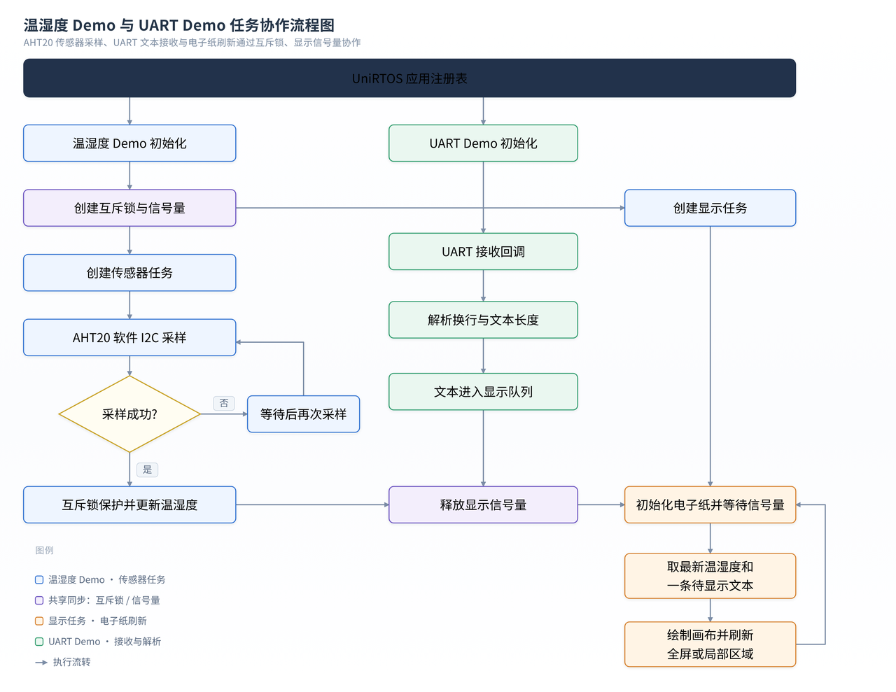
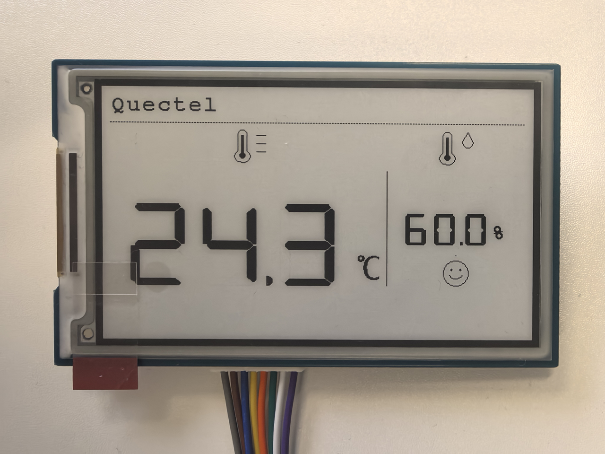

[English](README.md) | [简体中文](README_ZH.md)

# EG800Z-CN: E-Paper Temperature and Humidity Demo

## Project Overview

This UniRTOS external application displays AHT20 temperature and humidity readings, plus short text received over UART, on a 3.7-inch e-paper display. A sensor task periodically samples the AHT20, while a display task updates the screen when new sensor data or UART text is available.

## Workflow and Demo Images





## Features

- AHT20 measurements over software I2C
- Landscape 480 x 280 rendering on a 280 x 480 e-paper panel
- Full-screen initialization followed by regional monochrome refreshes
- UART1 line input with up to 27 printable ASCII characters per line
- Bounded text queue; when full, the oldest queued line is discarded
- Consistent application log prefix: `[e-ink_humiture_demo]`

## Development Preparation

### Hardware Requirements

- Quectel EG800Z-CN development board
- 3.7-inch e-paper module supported by the included EPD_3IN7 driver
- AHT20 sensor connected to the configured software-I2C pins
- USB data cable and an active SIM card for the cellular development board

### Hardware Connections

#### AHT20 Sensor

| AHT20 pin | EG800Z-CN connection | Description |
| --- | --- | --- |
| VCC | 3.3 V | Sensor power |
| GND | GND | Common ground |
| SCL | Module PIN 28 | Software-I2C clock |
| SDA | Module PIN 25 | Software-I2C data |

#### EPD_3IN7 E-Paper Module

| E-paper pin | EG800Z-CN connection | Description |
| --- | --- | --- |
| VCC | 3.3 V or 5 V, subject to the display board specification | Display power; check the board label/manual before connecting |
| GND | GND | Common ground |
| DIN | Module PIN 63 | SPI MOSI |
| CLK | Module PIN 49 | SPI clock |
| CS | Module PIN 64 | Chip select |
| DC | Module PIN 67 | Data/command select |
| RST | Module PIN 66 | Reset |
| BUSY | Module PIN 29 | Busy status |

#### USB-to-UART Adapter

| USB-UART pin | EG800Z-CN connection | Description |
| --- | --- | --- |
| GND | GND | Common ground |
| RXD | TXD2, module PIN 18 | Adapter receives board output; UART lines are crossed |
| TXD | RXD2, module PIN 17 | Adapter sends to board input; UART lines are crossed |

The AHT20 driver and e-paper interface configure 3.3 V I/O. Connect all grounds together, and verify the exact board revision and display-board input voltage before powering the setup.

### Software Requirements

- UniRTOS SDK 1.0.5, as configured in `env_config.json`
- UniRTOS command-line build environment
- EPAT or another supported tool for viewing device logs

## Quick Start

### 1. Set Up the Development Environment

Follow the [UniRTOS Quick Start](https://docs.quectel.com/zh/UniRTOS/UniRTOS%E6%96%87%E6%A1%A3/%E5%BF%AB%E9%80%9F%E4%B8%8A%E6%89%8B/%E5%BF%AB%E9%80%9F%E4%B8%8A%E6%89%8B.html) to install the toolchain and prepare the SDK.

### 2. Project Structure

```text
epd_th_tag/
├── main/
│   ├── inc/humiture_demo.h       # Shared settings and UART text API
│   ├── src/humiture_demo.c       # App registration, tasks, synchronization, rendering
│   ├── aht20/                    # AHT20 software-I2C driver
│   ├── uart/                     # UART setup and line parser
│   └── eink_sdk/
│       ├── Config/               # GPIO, SPI, delays, and device setup
│       ├── e-Paper/              # EPD_3IN7 controller driver
│       ├── Fonts/                # ASCII, DSEG7, unit, and Xin Song glyphs
│       └── GUI/                  # Canvas primitives, text, and icon drawing
├── menuconfig/                   # Application configuration
├── CMakeLists.txt                # External-app target and source collection
├── env_config.json               # UniRTOS SDK and default module configuration
├── README.md                     # English documentation
└── README_ZH.md                  # Chinese documentation
```

### 3. Build the Project

Run the environment setup from the project directory:

```powershell
unirtos-cli env-setup
```

Build for the default module. Replace the firmware version with one installed in your environment if needed:

```powershell
unirtos-cli build -m EG800ZCN_LA -v EG800ZCNLAR01A01_OCPU_20261104
```

### 4. Run and View Logs

Flash the generated firmware, connect the e-paper display and AHT20 sensor, then power on the board. Send printable ASCII text terminated by a newline to UART1 to display it in the header area. A typical log sequence is shown below; sensor values and text length vary with the actual input:

```text
[e-ink_humiture_demo] Sample: temperature=24.6 C, humidity=57.2%
e-Paper busy
e-Paper busy release
[e-ink_humiture_demo] UART display text queued, length=14/27
```

## Code Overview

### Main Modules

**Application coordination (`main/src/humiture_demo.c`, `main/inc/humiture_demo.h`)**

The application entry point initializes shared state and task synchronization, then starts the sensor-sampling and display flows. New readings or UART text notify the display task, which reads the current state and assembles the page. UART initialization is registered as a separate application module and passes received text to the display flow through the shared interface.

**Temperature and humidity sampling (`main/aht20/`)**

The AHT20 driver handles sensor communication, initialization, and measurement reads. The sampling flow calls the driver and updates the application's shared state; failed reads are not treated as new data for display.

**UART text input (`main/uart/`)**

The UART module initializes the serial interface and processes incoming characters into text lines, filtering unsupported input. Completed lines are handed to the application through its shared interface and placed in the display queue; the display flow takes queued text and updates the corresponding screen area.

**E-paper display (`main/eink_sdk/`)**

`Config/` manages low-level pins, SPI, and device initialization; `e-Paper/` wraps controller operations; and `GUI/` plus `Fonts/` provide drawing and text rendering. The application combines readings, status, and UART text into a page, then refreshes the relevant regions after the initial draw.

## Notes

- Verify module PIN numbers and signal wiring for the exact board revision.
- UART text is ASCII-only; UTF-8 multibyte text is rejected by the line parser.
- The sample firmware version in the build command is an example and may need to match the locally installed release.