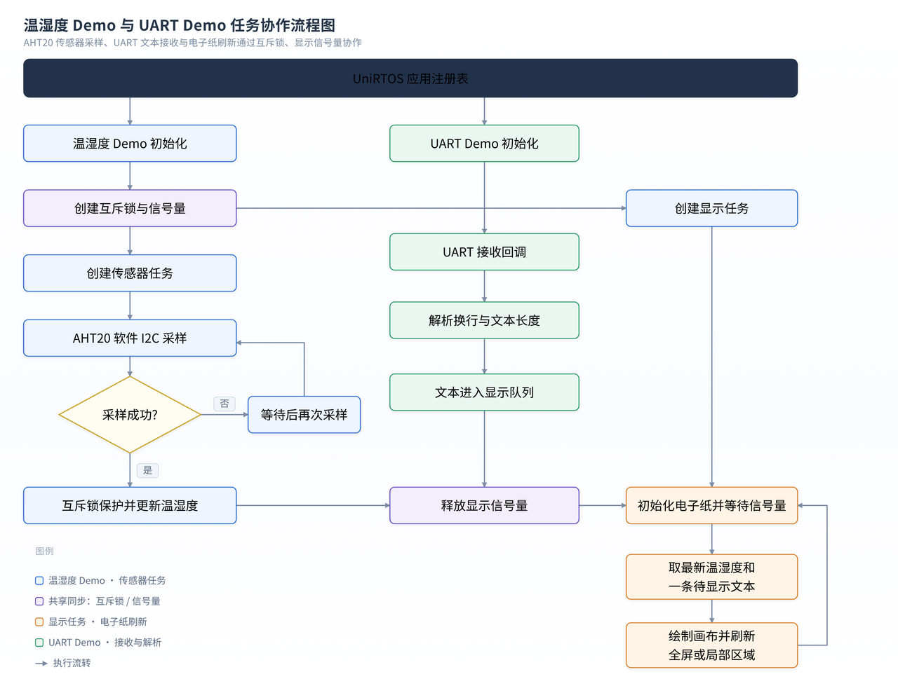
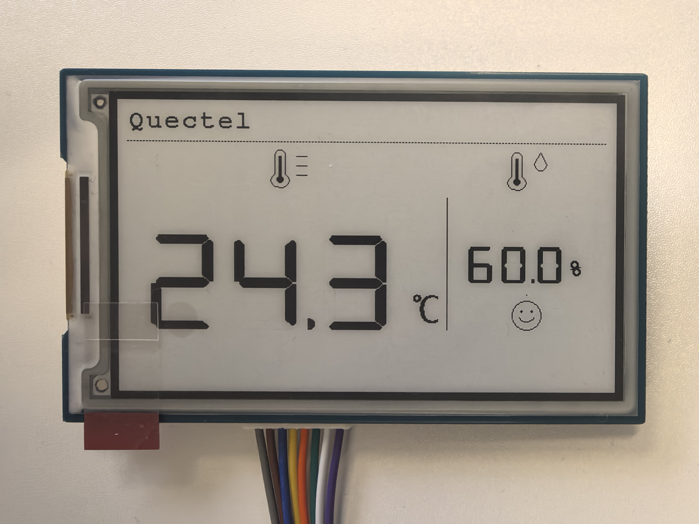

[English](README.md) | [简体中文](README_ZH.md)

# EG800Z-CN: E-Paper Temperature and Humidity Demo

## Project Overview

This UniRTOS external application example displays AHT20 temperature and humidity readings, as well as short text received over UART, on a 3.7-inch e-paper display. A sensor task periodically samples the data, and a display task updates the screen when new sensor data or UART text is available.

## Features

- Read AHT20 temperature and humidity over I2C using GPIO bit-banging
- Use SPI to control the e-paper display and send image data
- Receive UART messages and display them on the e-paper screen
- Perform a full-screen refresh at initialization, then use partial refreshes for labels and temperature/humidity updates; the refresh interval can be as short as 0.5 seconds
- Buffer up to 8 lines of display text; discard the oldest line when the queue is full

## Development Preparation

### Hardware Requirements

- Quectel EG800Z-CN development board
- 3.7-inch e-paper module (EPD_3IN7)
- AHT20 temperature and humidity sensor
- CP2102 USB-to-TTL UART adapter
- USB data cable
- Breadboard and jumper wires

### Hardware Connections

#### AHT20 Temperature and Humidity Sensor

| AHT20 pin | EG800Z-CN connection | Description |
| --- | --- | --- |
| VCC | 3.3 V | Sensor power |
| GND | GND | Common ground |
| SCL | Module PIN 28 | Software-I2C clock |
| SDA | Module PIN 25 | Software-I2C data |

#### EPD_3IN7 E-Paper Module

| E-paper pin | EG800Z-CN connection | Description |
| --- | --- | --- |
| VCC | 3.3 V or 5 V, according to the display board specification | Display power; check the board label/manual before connecting |
| GND | GND | Common ground |
| DIN | Module PIN 63 | SPI MOSI |
| CLK | Module PIN 49 | SPI clock |
| CS | Module PIN 64 | Chip select |
| DC | Module PIN 67 | Data/command select |
| RST | Module PIN 66 | Reset |
| BUSY | Module PIN 29 | Busy status output |

#### USB-to-UART Adapter

| USB-UART pin | EG800Z-CN connection | Description |
| --- | --- | --- |
| GND | GND | Common ground |
| RXD | TXD2, module PIN 18 | Adapter receives board output; TX and RX are crossed |
| TXD | RXD2, module PIN 17 | Adapter sends data to board input; TX and RX are crossed |

The AHT20 driver and e-paper interface use 3.3 V I/O. Connect all grounds together. Before powering on, verify the board revision, actual pin mapping, and the input voltage supported by the e-paper adapter board.

### Software Requirements

- UniRTOS SDK 1.0.5 (see `env_config.json`)
- UniRTOS command-line build environment
- EPAT or another supported device log viewer

## Quick Start

### 1. Set Up the Development Environment

Follow the [UniRTOS Quick Start](https://docs.quectel.com/zh/UniRTOS/UniRTOS%E6%96%87%E6%A1%A3/%E5%BF%AB%E9%80%9F%E4%B8%8A%E6%89%8B/%E5%BF%AB%E9%80%9F%E4%B8%8A%E6%89%8B.html) to install the toolchain and prepare the SDK.

### 2. Project Structure

```text
epd_th_tag/
├── main/
│   ├── inc/humiture_demo.h       # Shared configuration and UART text interface
│   ├── src/humiture_demo.c       # App registration, tasks, synchronization, and rendering
│   ├── aht20/                    # AHT20 software-I2C driver
│   ├── uart/                     # UART initialization and text-line parser
│   └── eink_sdk/
│       ├── Config/               # GPIO, SPI, delays, and device configuration
│       ├── e-Paper/              # EPD_3IN7 controller driver
│       ├── Fonts/                # ASCII, DSEG7, unit, and Xin Song glyphs
│       └── GUI/                  # Canvas primitives, text, and icon drawing
├── media/                        # Images
├── menuconfig/                   # Application configuration
├── CMakeLists.txt                # External-app target and source collection
├── env_config.json               # UniRTOS SDK and default module configuration
├── README.md                     # English documentation
└── README_ZH.md                  # Chinese documentation
```

### 3. Build the Project

Prepare the build environment from the project directory:

```powershell
unirtos-cli env-setup
```

Build the firmware for the default module. Replace the version with one installed in your environment if it differs:

```powershell
unirtos-cli build -m EG800ZCN_LA -v EG800ZCNLAR01A01_OCPU_20261104
```

### 4. Run and View Logs

Flash the generated firmware, connect the e-paper display and AHT20 sensor, and power on the board. Send printable ASCII text terminated by a newline to UART1 to display it in the screen's title area.

A typical log sequence is shown below. Sample values and text length vary with the actual data:

```text
[e-ink_humiture_demo] Sample: temperature=24.6 C, humidity=57.2%
e-Paper busy
e-Paper busy release
[e-ink_humiture_demo] UART display text queued, length=14/27
```

## Code Overview

### Application Workflow



### Main Modules

**Application coordination (`main/src/humiture_demo.c`, `main/inc/humiture_demo.h`)**

The application entry point initializes shared data and task synchronization, then starts the sensor-sampling and display flows. New readings or UART text notify the display task, which reads the current data and assembles the page. UART initialization is registered as a separate application module and passes text to the display flow through a shared interface.

**Temperature and humidity sampling (`main/aht20/`)**

The AHT20 driver handles sensor communication, initialization, and measurement reads. The sampling flow uses the driver to obtain temperature and humidity readings and updates the shared application state. Failed reads are not treated as new data for the display task.

**UART text input (`main/uart/`)**

The UART module initializes the serial interface and processes received characters into text lines, filtering unsupported input. Completed lines are passed to the application through its shared interface and placed in the display queue. The display flow takes text from the queue and updates the corresponding screen area.

**E-paper display (`main/eink_sdk/`)**

`Config/` manages low-level pins, SPI, and device initialization; `e-Paper/` wraps display-controller operations; and `GUI/` and `Fonts/` provide drawing and text-rendering capabilities. The application combines temperature, humidity, status, and UART text into a page. After the initial draw, it refreshes the relevant regions according to the updates.

## Actual Display



## Notes

- Verify module PIN numbers and signal wiring for the exact development-board hardware revision.
- UART text supports ASCII only; UTF-8 multibyte characters are not supported.
- The firmware version in the build command is an example; replace it with a version installed in your environment.
