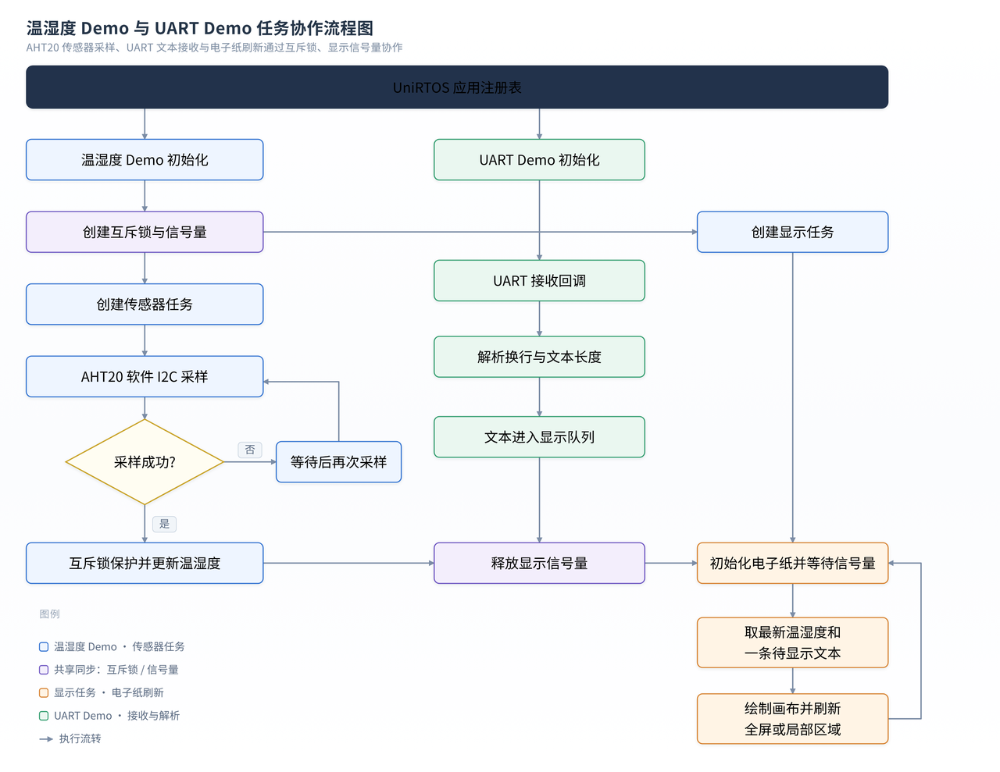
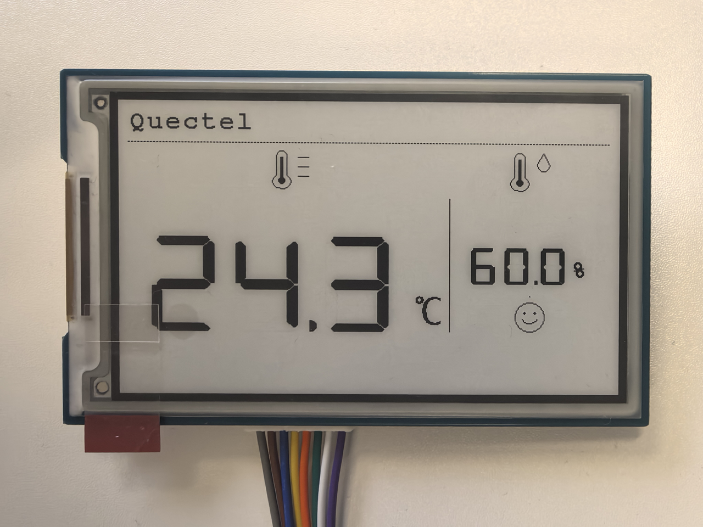

[English](README.md) | [简体中文](README_ZH.md)

# EG800Z-CN：墨水屏温湿度 Demo

## 工程概述

本工程是基于 UniRTOS 的外部应用示例，在 3.7 英寸电子纸上显示 AHT20 温度、湿度，以及通过 UART 接收的短文本。传感器任务周期采集数据，显示任务在收到新数据或串口文本后更新画面。


## 功能特性

- 通过GPIO复用I2C读取 AHT20 温湿度
- 通过SPI控制并发送画面信息给到墨水屏
- 获取串口消息，并显示到墨水屏
- 初始化时全屏刷新，后续更新标签和温湿度使用局部刷新，可提高刷新间隔到0.5S
- 显示文本队列最多缓存 8 行；队列满时丢弃最旧文本


## 开发准备

### 硬件要求

- 移远 EG800Z-CN 开发板
- 3.7 英寸墨水屏模块（EPD_3IN7）
- AHT20 温湿度传感器
- CP2102 USB 转 TTL UART 串口模块
- USB 数据线
- 面包板及若干杜邦线


### 硬件连接

#### AHT20 温湿度传感器

| AHT20 引脚 | EG800Z-CN 开发板连接 | 说明 |
| --- | --- | --- |
| VCC | 3.3 V | 传感器电源 |
| GND | GND | 共地 |
| SCL | 模组 PIN 28 | 软件 I2C 时钟 |
| SDA | 模组 PIN 25 | 软件 I2C 数据 |

#### EPD_3IN7 电子纸模块

| 电子纸引脚 | EG800Z-CN 开发板连接 | 说明 |
| --- | --- | --- |
| VCC | 3.3 V 或 5 V，按屏幕板规格选择 | 屏幕电源；接线前核对屏幕板标识/手册 |
| GND | GND | 共地 |
| DIN | 模组 PIN 63 | SPI MOSI |
| CLK | 模组 PIN 49 | SPI 时钟 |
| CS | 模组 PIN 64 | 片选信号 |
| DC | 模组 PIN 67 | 数据/命令选择 |
| RST | 模组 PIN 66 | 复位 |
| BUSY | 模组 PIN 29 | 忙状态输出 |

#### USB 转 UART 模块

| USB-UART 引脚 | EG800Z-CN 开发板连接 | 说明 |
| --- | --- | --- |
| GND | GND | 共地 |
| RXD | TXD2，模组 PIN 18 | 串口模块接收开发板输出；TX/RX 交叉连接 |
| TXD | RXD2，模组 PIN 17 | 串口模块发送至开发板输入；TX/RX 交叉连接 |

AHT20 驱动和电子纸接口配置为 3.3 V IO。所有设备需要共地；上电前请确认开发板硬件版本、实际引脚映射以及电子纸转接板允许的输入电压。


### 软件要求

- UniRTOS SDK 1.0.5（见 `env_config.json`）
- UniRTOS 命令行构建环境
- EPAT 或其他受支持的设备日志查看工具

## 快速上手

### 1. 搭建开发环境

参考 [UniRTOS 快速入门](https://docs.quectel.com/zh/UniRTOS/UniRTOS%E6%96%87%E6%A1%A3/%E5%BF%AB%E9%80%9F%E4%B8%8A%E6%89%8B/%E5%BF%AB%E9%80%9F%E4%B8%8A%E6%89%8B.html)，安装工具链并准备 SDK。

### 2. 项目结构

```text
epd_th_tag/
├── main/
│   ├── inc/humiture_demo.h       # 共享配置及 UART 文本接口
│   ├── src/humiture_demo.c       # 应用注册、任务、同步及页面绘制
│   ├── aht20/                    # AHT20 软件 I2C 驱动
│   ├── uart/                     # UART 初始化与文本行解析
│   └── eink_sdk/
│       ├── Config/               # GPIO、SPI、延时和设备配置
│       ├── e-Paper/              # EPD_3IN7 控制器驱动
│       ├── Fonts/                # ASCII、DSEG7、单位和新宋体字模
│       └── GUI/                  # 画布图元、文字及图标绘制
├── media                         # 图片
├── menuconfig/                   # 应用配置
├── CMakeLists.txt                # 外部应用目标和源文件收集
├── env_config.json               # UniRTOS SDK 与默认模组配置
├── README.md                     # 英文说明
└── README_ZH.md                  # 中文说明
```

### 3. 构建项目

在项目目录下准备构建环境：

```powershell
unirtos-cli env-setup
```

为默认模组构建固件。如本机安装的固件版本不同，请替换版本号：

```powershell
unirtos-cli build -m EG800ZCN_LA -v EG800ZCNLAR01A01_OCPU_20261104
```

### 4. 运行与查看日志

烧录生成的固件，连接电子纸和 AHT20 后给开发板上电。向 UART1 发送以换行符结束的可打印 ASCII 文本，即可在屏幕标题区域显示。
运行时可在日志工具中看到类似输出，采样值和文本长度会随实际数据变化：

```text
[e-ink_humiture_demo] Sample: temperature=24.6 C, humidity=57.2% 
e-Paper busy 
e-Paper busy release 
[e-ink_humiture_demo] UART display text queued, length=14/27 
```


## 代码概览

### 应用流程



### 主要模块

**应用协调（`main/src/humiture_demo.c`、`main/inc/humiture_demo.h`）**

应用入口负责初始化共享数据和任务间同步机制，并启动传感器采集与屏幕显示流程。采集到的新读数或收到新的串口文本后，应用协调层通知显示任务；显示任务读取当前数据并组织页面内容。UART 初始化作为独立应用模块注册，再通过共享接口把文本交给显示流程。

**温湿度采集（`main/aht20/`）**

AHT20 驱动负责传感器通信、初始化和测量数据读取。上层采集流程调用驱动取得温湿度结果，并更新应用共享状态；采集失败时不会把无效读数当作新数据通知显示任务。

**串口文本输入（`main/uart/`）**

UART 模块负责串口初始化和接收回调，将连续到达的字符整理为一行文本，并过滤不支持的输入。完整文本通过应用接口进入待显示队列；显示流程从队列取出内容并更新屏幕上的文本区域。

**电子纸显示（`main/eink_sdk/`）**

`Config/` 管理底层引脚、SPI 和设备初始化，`e-Paper/` 封装屏幕控制器操作，`GUI/` 与 `Fonts/` 提供绘图和文字渲染能力。应用显示流程组合温湿度、状态和串口文本形成页面，首次绘制后按更新内容选择相应区域刷新。

## 实物效果



## 注意事项

- 请按开发板具体硬件版本确认模块 PIN 编号和信号接线。
- UART 文本仅支持 ASCII，不支持 UTF-8 多字节字符。
- 构建命令中的固件版本号为示例，请替换为本机已安装的版本。
