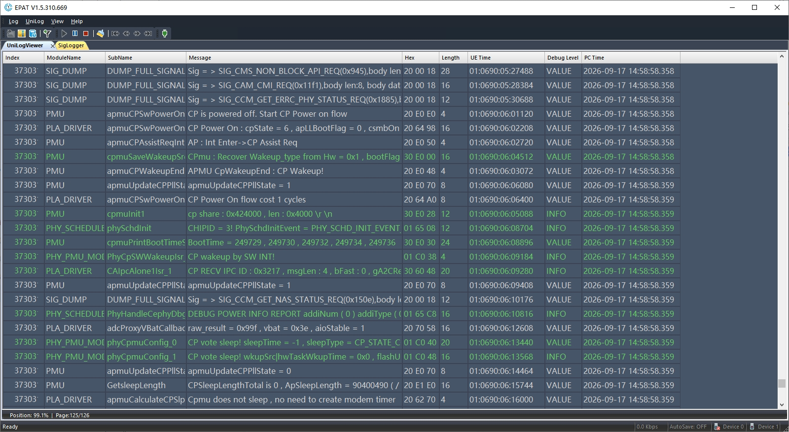
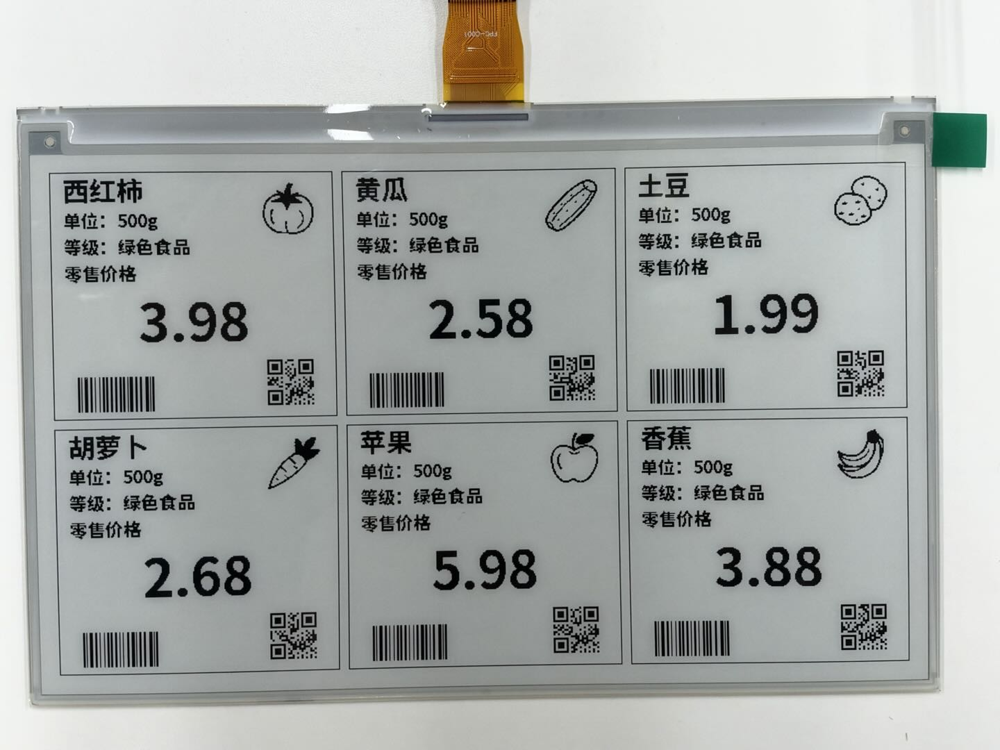

# 墨水屏电子价签

[English](README.md)

墨水屏电子价签方案是一个基于 UniRTOS 构建的商品信息展示与低内存图形输出示例。

系统通过同一工程组织三列两行共六个商品区域，采用真实中文黑体点阵和统一页面布局，支持结构化商品数据校验、逐行渲染、安装方向补偿、全屏更新和屏幕深度休眠。PC 预览与设备使用相同的 C 排版和渲染代码，可在烧录前检查文字、图片及码图的布局。

## 开发资源

| 资源名称 | 数量 | 简要描述 |
| --- | --- | --- |
| Quecduino 开发板 | 1 | 搭载 EG800ZCN_LA，使用与本项目一致的引脚映射 |
| 7.5 英寸 V2 单色墨水屏 | 1 | 800 × 480，匹配当前 V2 OTP 全屏刷新驱动 |
| 墨水屏驱动板 | 1 | 当前硬件使用带 PWR 使能的 E-Paper Driver HAT Rev2.3 |
| 电源及连接线 | 1 套 | 稳定的屏幕电源、杜邦线及可靠共地 |
| USB 数据线 | 1 | 连接开发板与 PC，不可使用仅充电线 |
| PC | 1 | Windows 10 / Windows 11 |

## 快速上手

### 硬件连接

1. 断开开发板及墨水屏电源，正确连接屏幕排线并锁紧接口。
2. 按下表连接主控和驱动板，确保共地。
3. 确认屏幕供电及信号电平符合硬件要求。当前工程设置模组 IO 为 3.3 V，屏幕使用稳定的 3.3 V 电源。
4. 使用 USB 数据线连接开发板与 PC，检查无误后上电。

| 墨水屏信号 | Quecduino 接口 | 模组 PIN | QOSA GPIO | 说明 |
| --- | --- | --- | --- | --- |
| DIN | D11 | 63 | GPIO13 | 数据输出 |
| CLK | D13 | 49 | GPIO15 | 时钟输出 |
| CS | D10 | 64 | GPIO12 | 片选 |
| DC | D9 | 67 | GPIO9 | 命令 / 数据选择 |
| RST | D8 | 66 | GPIO8 | 复位 |
| BUSY | D7 | 29 | GPIO11 | 忙状态输入 |
| PWR | D6 | 28 | GPIO10 | 驱动板使能，不是供电输出 |
| GND | GND | 不适用 | 不适用 | 共地 |
| VCC | 稳定的 3.3 V 电源 | 不适用 | 不适用 | 不可由 GPIO 直接供电 |

### 软件部署

#### 开发环境搭建

参考[UniRTOS快速入门](https://docs.quectel.com/zh/UniRTOS/UniRTOS文档/快速上手/快速上手.html)完成开发环境安装，并确认unirtos-cli可在PowerShell中使用。

#### 代码获取

新开启PowerShell窗口，执行以下命令：

```PowerShell
unirtos-cli new -r unirtos-maker-examples
cd unirtos-maker-examples/e-ink_screen
```

#### 配置参数

| 配置类别 | 配置位置 / 配置项 | 说明 |
| --- | --- | --- |
| 模组与 SDK | [env_config.json](env_config.json) | EG800ZCN_LA、SDK 1.0.5 |
| 演示开关 | [main/inc/epaper_demo_config.h](main/inc/epaper_demo_config.h)：`EPD_DEMO_ENABLED` | 默认 `1`，启动显示任务 |
| 屏幕尺寸 | 同上：`EPD_WIDTH`、`EPD_HEIGHT` | 固定为 800 × 480，不能仅修改宏适配其他屏幕 |
| GPIO 映射 | 同上：`EPD_*_PIN`、`EPD_*_GPIO`、`EPD_*_FUNC` | 默认接线见上表 |
| BUSY 超时 | 同上：`EPD_BUSY_TIMEOUT_MS` | 默认 30000 ms |
| 屏幕使能 | 同上：`EPD_PWR_ENABLED`、`EPD_PWR_STARTUP_MS` | 默认启用，等待 100 ms |
| 软件 SPI 延时 | 同上：`EPD_SOFT_SPI_DELAY_LOOPS` | 默认 32，是循环次数，不是已校准的频率 |
| 通信抓取 | 同上：`EPD_SPI_CAPTURE_BURSTS` | 默认 `0`，正常演示关闭诊断突发 |
| 商品数据 | [main/src/price_tag_data.c](main/src/price_tag_data.c) | 六条商品记录，价格使用整数分 |
| 页面布局与方向 | [main/src/price_tags.c](main/src/price_tags.c) | 三列两行布局；设备输出补偿 180° |

#### 构建项目

在工程根目录的 PowerShell 中执行：

```powershell
unirtos-cli env-setup
unirtos-cli build -m EG800ZCN_LA
```

构建成功后，命令行末尾将显示：

```text
SUCCESS: Unirtos project built successfully!
```

通过QFlash工具将生成的固件烧录至开发板。

### 验证项目

1. 打开 EPAT 日志工具，参考 [UniRTOS 日志调试](https://www.quectel.com.cn/unirtos/docs?docs_page=快速上手/日志调试/日志调试.html) 完成配置，从模组启动开始抓取日志。
2. 检查 `EPD app init: creating display task` 及 `EPD price tags: SOFTWARE SPI` 日志，确认显示任务已启动。
3. 等待清屏和目标页面全屏刷新完成。全刷期间出现黑白切换属于正常过程。
4. 检查六种商品的名称、说明、价格、插图及两种码图是否完整，安装方向是否正确。
5. 确认日志包含 `EPD price tag transfer complete`，并检查刷新后画面保持。
6. 使用实际扫码设备逐个核对条形码和二维码编号。



图片文件：[epat_logs.jpg](media/epat_logs.jpg)

## 项目结构

```text
unirtos-msp/
├── README.md                 # 英文说明
├── README_zh.md              # 中文说明
├── CMakeLists.txt            # SDK 外部应用构建入口
├── env_config.json           # 模组与 SDK 配置
├── menuconfig/
│   └── .config               # 工程功能配置
├── main/
│   ├── inc/                  # 配置、驱动及价签接口
│   └── src/                  # 应用、渲染器、驱动和只读 C 资源
└── media/                    # README 使用的图片
    ├── epat_logs.jpg
    └── epaper_price_tags.jpg
```

## 应用演示

按开发板正常流程上电后，系统自动运行已注册的墨水屏应用。完成初始化、清屏和目标页面刷新后，屏幕进入休眠并保留六商品画面，无需通过触摸或按键进入页面。

### 六商品价签

| 商品 | 单位 | 价格（元） | 演示编号 |
| --- | --- | --- | --- |
| 西红柿 | 500g | 3.98 | 100001 |
| 黄瓜 | 500g | 2.58 | 100002 |
| 土豆 | 500g | 1.99 | 100003 |
| 胡萝卜 | 500g | 2.68 | 100004 |
| 苹果 | 500g | 5.98 | 100005 |
| 香蕉 | 500g | 3.88 | 100006 |



