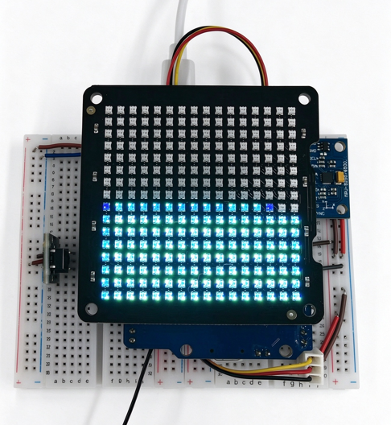

# Fluid Matrix Lamp

[中文](README_zh.md)

Fluid Matrix Lamp is an interactive lighting example built on UniRTOS, using an EG800Z QuecDuino development board, a 16 × 16 WS2812 LED matrix, and an MPU6500 motion sensor.

The project combines motion sensing, LED matrix rendering, and single-button interaction. It provides three modes: gravity-driven fluid simulation, a synthesized spectrum animation, and facial expressions. The gravity mode uses a two-dimensional FLIP/PIC fluid solver so that the fluid moves toward the lower side as the board tilts. The spectrum mode is generated algorithmically and does not require audio input. The expression mode displays happy, sad, surprised, and heart patterns.

This example demonstrates UniRTOS SPI, I2C, GPIO, and multitasking capabilities, and serves as a reference for interactive lamps, motion-controlled displays, and LED matrix applications.



## Development Resources

| Resource | Quantity | Description | How to Obtain |
| :------- | :------- | :---------- | :------------ |
| QuecDuino development board | 1 | EG800Z board; the project build configuration uses EG800ZCN_LA. | [Buy here](https://www.quecmall.com/goods-detail/2c90800b9e4a2da8019e71fa2b3000df) |
| USB data cable | 1 | Connects the PC and development board; use a data-capable USB-A to USB-C cable. | Self-provided |
| PC | 1 | Windows 10/Windows 11. | Self-provided |
| WS2812 LED matrix | 1 | 16 × 16 matrix, 256 LEDs; the matrix used in this example operates with a 3.3 V supply. | Self-provided |
| MPU6500 module | 1 | I2C motion sensor; connect AD0 to GND for address 0x68. | Self-provided |
| Momentary button | 1 | Active-low mode button, connected between PIN 28 and GND. | Self-provided |
| Jumper wires and power supply | As needed | Connect the peripherals and provide a supply suitable for the matrix load. | Self-provided |

## Quick Start

### Hardware Connection

Disconnect power before wiring. The following connections correspond to the existing project wiring description. Pin numbers refer to the development board pins, not GPIO numbers.

| Peripheral Signal | Board Connection | Description |
| :---------------- | :--------------- | :---------- |
| Matrix VCC | 3.3 V supply | Use a supply suitable for the matrix load and verify the actual matrix specification. |
| Matrix GND | GND | Share ground with the development board and sensor. |
| Matrix DIN | PIN 67 | SPI0_MOSI, alternate function 1; connect to the matrix data input. |
| MPU6500 VCC / GND | Supply matching the module specification / GND | Check the sensor module's supply requirements before connecting. |
| MPU6500 SCL | PIN 57 | I2C0_SCL, alternate function 2, 400 kHz. |
| MPU6500 SDA | PIN 58 | I2C0_SDA, alternate function 2. |
| MPU6500 AD0 | GND | Selects I2C address 0x68. |
| Mode button | PIN 28 / GND | Internal pull-up, active low. |

1. Connect the matrix, MPU6500, and button as shown above, with a common ground.
2. The matrix used in this example was reported to work with a 3.3 V supply and direct 3.3 V data input. This is not a universal supply specification for WS2812 products; check your matrix's voltage and logic-level requirements. Do not assume the board's 3.3 V output can power all 256 LEDs at full brightness.
3. Only PIN 67 is multiplexed to SPI for matrix output. PIN 28 is also SPI0_MISO, but is used as GPIO here. If another SPI0 device needs MISO or SCLK, review the pin allocation before connecting it.
4. The default matrix layout starts at the top-left corner and uses serpentine rows. Adjust the layout configuration if your matrix differs.
5. Connect the development board to the PC with the USB data cable. Keep the board horizontal and still during the approximately 1.5-second startup calibration.

### Software Deployment

#### Setting Up the Development Environment

Refer to [UniRTOS Quick Start](https://docs.quectel.com/zh/UniRTOS/UniRTOS文档/快速上手/快速上手.html) to install the development environment, and make sure unirtos-cli is available in PowerShell.

#### Pulling the Code

Open a new PowerShell window and run:

```PowerShell
unirtos-cli new -r unirtos-maker-examples
cd unirtos-maker-examples/fluid_matrix_lamp
```

#### Project Structure

```text
fluid_matrix_lamp/
├── main/
│   ├── inc/config/
│   │   ├── board_config.h    # Pins, buses, matrix layout, and gravity mapping
│   │   └── app_config.h      # Brightness, timing, fluid parameters, and logging
│   └── src/
│       ├── main.c            # Application entry and task initialization
│       ├── drivers/          # MPU6500 and WS2812 drivers
│       ├── gfx/              # Framebuffer and FLIP/PIC fluid solver
│       ├── hal/              # Display, motion sensor, and button interfaces
│       ├── modes/            # Gravity, spectrum, and expression modes
│       └── util/             # Time base and pseudo-random utilities
├── menuconfig/               # Project feature configuration
├── CMakeLists.txt            # Project build script
├── env_config.json          # UniRTOS environment configuration
├── LICENSE                  # Project license
├── THIRD-PARTY-NOTICES.md    # Third-party notices
├── README.md                # English instructions
└── README_zh.md             # Chinese instructions
```

#### Modifying Configuration Parameters

Hardware configuration is centralized in [main/inc/config/board_config.h](main/inc/config/board_config.h), and application parameters are in [main/inc/config/app_config.h](main/inc/config/app_config.h).

| Category | Configuration | Description |
| :------- | :------------ | :---------- |
| Wiring | Pin and bus definitions in `board_config.h` | Match the matrix, sensor, and button connections. |
| Matrix layout | `BOARD_MATRIX_SERPENTINE`, `BOARD_MATRIX_ORIGIN_TOP` | Match the LED wiring order and origin. |
| Gravity mapping | `BOARD_GRAV_MX_AX/AY/AZ`, `BOARD_GRAV_MY_AX/AY/AZ` | Map sensor acceleration to screen coordinates according to the mounting orientation. |
| Brightness | `APP_MASTER_BRIGHTNESS` | Overall display brightness; the existing project description specifies 36. |
| LED output limit | `APP_POWER_LIMIT_SUM` | Limits the aggregate LED output values. |

Expression bitmaps are defined in [main/src/modes/mode_face.c](main/src/modes/mode_face.c), and spectrum animation parameters are in [main/src/modes/mode_spectrum.c](main/src/modes/mode_spectrum.c). Fluid gravity strength, FLIP blending, and initial fill parameters are in [main/src/gfx/fluid2d.c](main/src/gfx/fluid2d.c).

#### Building the Project

Run the following in PowerShell:

```PowerShell
unirtos-cli env-setup
unirtos-cli build -m EG800ZCN_LA
```

The module selection matches [env_config.json](env_config.json). After a successful build, the end of the command line shows:

```Plain
SUCCESS: Unirtos project built successfully!
```

Flash the generated firmware to the development board with the QFlash tool.

#### Verifying the Project

1. Power on the board and use EPAT to capture logs from startup. Refer to the [log debugging tutorial](https://www.quectel.com.cn/unirtos/docs?docs_page=快速上手/日志调试/日志调试.html). Filter logs by `[LEDMPU]`.
2. Check the startup corner colors: top-left red, top-right green, bottom-left blue, and bottom-right yellow. If the positions differ, review the matrix layout configuration.
3. Keep the board horizontal and still during startup calibration. A blue progress bar is displayed, and `calibration done` indicates completion.
4. Gravity mode starts by default. Tilt the board toward each edge and check that the fluid moves toward the lower side. If the direction is reversed, review the sensor mounting and gravity mapping.
5. Use the button to verify the following interactions. Successful changes are indicated by a two-frame white flash, followed by a 200 ms button lockout.

| Operation | Expected Behavior |
| :-------- | :---------------- |
| Short press | Cycle through gravity → spectrum → expression → gravity. |
| Long press, at least 1 second, in expression mode | Cycle through happy, sad, surprised, and heart expressions. |
| Long press in gravity or spectrum mode | No mode change. |
| Observe spectrum mode | Animated columns and peaks without audio input. |
| Observe the heart expression | Heart size changes to produce a beating animation. |

The following log fragments are examples; actual values depend on the hardware and configuration:

```Plain
[LEDMPU] I mpu6500_init: who_am_i=0x70 -> sensor detected
[LEDMPU] I calibration_accumulate: calibration done: bias(x,y,z)=...
[LEDMPU] I mode: mode switched -> spectrum (short press) ...
[LEDMPU] I stats_task: stats: mode=gravity fps=... tx=... drop=0 spi_err=0 ...
```

If the matrix remains dark, check the supply, common ground, DIN direction, and PIN 67 connection first. If calibration or gravity direction is incorrect, restart with the board horizontal and still, then check the I2C wiring and axis mapping.

## Community & Support

- [UniRTOS Community](https://forumschinese.quectel.com/c/66-category/66): Ask questions and share projects in the official forum (Chinese).
- [Quectel Forums](https://forums.quectel.com/): Discuss Quectel modules in English.
- [Report an Issue](https://github.com/UniRTOS/unirtos-maker-examples/issues): Report code or documentation problems with reproduction steps.
- [Contribute a Fix or Example](https://github.com/UniRTOS/unirtos-maker-examples/pulls): Submit a pull request with a summary and verification results.

## License

See [THIRD-PARTY-NOTICES.md](THIRD-PARTY-NOTICES.md) for the third-party attribution, including the fluid solver derived from [embedded-fluid2d](https://github.com/ccbycc/embedded-fluid2d).
