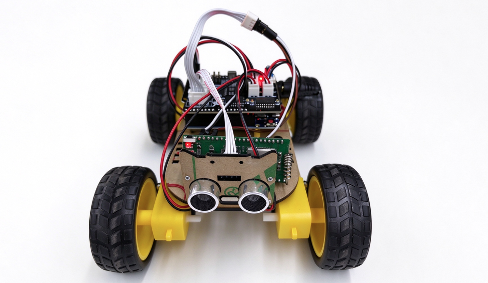

# Intelligent RC Car

[简体中文](README_zh.md)

The Intelligent RC Car demo is a cellular remote-control solution for an obstacle-avoidance car built on UniRTOS.

Running on a Quectel EG800ZCN_LA module, the demo connects to the Alibaba Cloud IoT Platform over MQTT through the cellular network, receives JSON control commands from the cloud, and forwards them as single-byte commands over UART1 to the Arduino UNO main board of the car. The UNO firmware drives the motors through a 74HCT595 shift register and PWM, and uses an HC-SR04 ultrasonic sensor for automatic obstacle avoidance. Because control travels over the cellular network, the car can be driven from anywhere, without being limited by Bluetooth or Wi-Fi range.

The project includes a browser remote-control page that connects to Alibaba Cloud over MQTT over WebSocket. Hold a direction button to drive and release it to stop. The page also provides automatic forward driving, emergency stop, and 10-level speed control, and displays the cloud connection status, car online status, and command acknowledgments with round-trip time. On the device side, motion commands use acknowledgment-based retransmission, and the module stops the car automatically when the cloud link drops. This project serves as a reference for cellular remote control, cloud-to-device command delivery, and module-to-MCU serial bridging.



# Development Resources

| Resource | Quantity | Description | How to Obtain |
| :--- | :--- | :--- | :--- |
| Pico development board | 1 | Hardware platform for the demo; must carry the "EG800ZCN_LA" module. | [Buy here](https://www.quecmall.com/goods-detail/2c90800b987f06090198aca7bde100a6) |
| Arduino UNO obstacle-avoidance car | 1 set | Car chassis with an Arduino UNO main board, a 74HCT595-based motor driver board, DC motors, and an HC-SR04 ultrasonic sensor. | [Reference link](https://item.taobao.com/item.htm?id=1030778130041&mi_id=0000RuW-gDmYqmdl1xP_rNbPzhjG1Bqte_7GIh7RXYUYrQs&spm=tbpc.boughtlist.suborder_itemtitle.1.116d2e8dwXaRi6&skuId=6210011631699) |
| Logic level shifter | 1 | Recommended. The module UART runs at 3.3 V while the UNO runs at 5 V. | Prepare separately |
| Dupont wires | Several | Connect the module UART to the UNO serial port. | Prepare separately |
| SIM card | 1 | USIM card with an active mobile data plan, used for the MQTT connection. | Prepare separately |
| USB data cable | 2 | One USB-A to USB-C data cable for the development board and one MicroUSB cable for the UNO; charge-only cables are not supported. | Prepare separately |
| PC | 1 | Windows 10 or Windows 11 for development, firmware flashing, and UNO programming. | Prepare separately |
| Phone or PC browser | 1 | Opens the remote-control page. A recent version of Chrome, Edge, or Safari is recommended. | Prepare separately |

In addition to the hardware, the following software and cloud resources are required:

| Resource | Description |
| :--- | :--- |
| Alibaba Cloud IoT Platform instance | Used for device authentication and message forwarding. Record the MQTT endpoint of the instance. |
| Arduino IDE | Compiles and uploads the UNO firmware [uno_car.ino](uno_fw/uno_car.ino). |

# Quick Start

## Hardware Connection

The module communicates with the UNO over UART1 at 9600 baud, 8N1, without flow control. Connect the pins as follows:

| Module | UNO | Description |
| :--- | :--- | :--- |
| pin 18 (UART1 TX) | D0 (RX) | Module sends control commands to the UNO. |
| pin 17 (UART1 RX) | D1 (TX) | UNO returns `CMD:<byte>` acknowledgments and debug output. |
| GND | GND | Common ground; required. |
| 5 V | 5 V | The Pico can be powered through the pin labeled "5V." Connect it there when the car is not being powered via USB. **During debugging, use USB power; do not use both power sources at the same time.** |

1. Insert the SIM card into the development board and connect the cellular antenna.
2. Connect the module and the UNO as shown in the table above. The application sets the module GPIO voltage to 3.3 V, and the UNO TX outputs 5 V, so place a level shifter at least on the UNO TX → module pin 17 path.
3. Connect the development board to the PC using the USB data cable.
4. Power the car from its own battery pack.

> D0/D1 of the UNO are shared with its USB serial port. Disconnect the module wires from D0/D1 before uploading the UNO firmware, and reconnect them afterwards.

## Software Deployment

### Development Environment

Follow the [UniRTOS Quick Start](https://docs.quectel.com/zh/UniRTOS/UniRTOS文档/快速上手/快速上手.html) to install the development environment and confirm that `unirtos-cli` is available in PowerShell.

### Get the Code

Open a new PowerShell window and run:

```powershell
# Pull the example repository
unirtos-cli new -r unirtos-maker-examples
# Enter the project directory
cd unirtos-maker-examples/intelligent_rc_car
```

### Configure Alibaba Cloud

The car and the remote-control page connect to Alibaba Cloud as two separate devices, and the cloud forwards messages between them.

1. In the Alibaba Cloud IoT Platform console, create a product. Each device of the product has the default custom topics `/${ProductKey}/${DeviceName}/user/update` (publish) and `/${ProductKey}/${DeviceName}/user/get` (subscribe).
2. Under the product, create two devices, for example `car_dev` for the car and `web_remote` for the remote-control page. Record the `ProductKey`, `DeviceName`, and `DeviceSecret` of each device.
3. Use the message forwarding (data forwarding) rules of the IoT Platform to republish messages between the two devices:

| Source Topic | Destination Topic | Purpose |
| :--- | :--- | :--- |
| `/${ProductKey}/web_remote/user/update` | `/${ProductKey}/car_dev/user/get` | Delivers control commands from the page to the car. |
| `/${ProductKey}/car_dev/user/update` | `/${ProductKey}/web_remote/user/get` | Returns acknowledgments and status from the car to the page. |

### Configure the Project

Cloud settings are defined in [car_cloud_config.h](main/inc/car_cloud_config.h). Replace the device triple and endpoint with your own values before building:

```c
#define CAR_CLOUD_SERVER_ADDR          "your instance MQTT endpoint"
#define CAR_CLOUD_SERVER_PORT          (1883)
#define CAR_CLOUD_PRODUCT_KEY          "your ProductKey"
#define CAR_CLOUD_DEVICE_NAME          "car_dev"
#define CAR_CLOUD_DEVICE_SECRET        "DeviceSecret of the car device"
```

Other settings usually do not need to be changed:

| Category | Setting | Description |
| :--- | :--- | :--- |
| MQTT endpoint | `CAR_CLOUD_SERVER_ADDR`, `CAR_CLOUD_SERVER_PORT` | Use the endpoint shown on the instance details page, for example `iot-xxxx.mqtt.iothub.aliyuncs.com` or `{ProductKey}.iot-as-mqtt.{RegionId}.aliyuncs.com`. The device connects over plain TCP port `1883` and signs in with HMAC-SHA1 (`securemode=3`). |
| Topics | `CAR_CLOUD_TOPIC_DOWNLINK`, `CAR_CLOUD_TOPIC_UPLINK` | Generated from the triple: subscribes to `/user/get` and publishes to `/user/update`. |
| Connection timing | `CAR_CLOUD_BOOT_DELAY_S`, `CAR_CLOUD_KEEP_ALIVE_S`, `CAR_CLOUD_CONNECT_TIMEOUT_MS`, `CAR_CLOUD_RETRY_DELAY_S` | Defaults: wait `3 s` for the network after boot, `60 s` keepalive, `60000 ms` connection timeout, and reconnect `30 s` after a disconnection. |

### Build the Project

Run the environment setup command in PowerShell:

```powershell
unirtos-cli env-setup
```

Then build the firmware:

```powershell
unirtos-cli build -m EG800ZCN_LA
```

After a successful build, the command output ends with:

```text
SUCCESS: Unirtos project built successfully!
```

Use QFlash to flash the generated firmware onto the development board.

### Program the UNO

1. Open [uno_car.ino](uno_fw/uno_car.ino) in the Arduino IDE.
2. Select the **Arduino Uno** board and the corresponding serial port, then upload the sketch.
3. After uploading, reconnect the module wires to D0/D1 of the UNO.

The UNO firmware must be this version. It returns `CMD:<byte>` for each motion command, which the module uses to confirm delivery.

### Configure the Remote-Control Page

1. Open [smallcar_remote.html](remote_control/smallcar_remote.html) in a browser on a phone or PC. The page can be opened as a local file or served over HTTP.
2. Tap the gear button (⚙) in the upper-right corner and fill in the connection settings:

| Field | Description |
| :--- | :--- |
| Instance endpoint | MQTT endpoint of the Alibaba Cloud instance, the same as `CAR_CLOUD_SERVER_ADDR`. |
| ProductKey | ProductKey of the product. |
| Web device DeviceName | DeviceName of the device used by the page, for example `web_remote`. |
| Web device DeviceSecret | DeviceSecret of the device used by the page. |
| Car DeviceName | DeviceName of the car device, for example `car_dev`. |
| Protocol | `ws` is recommended and works in all browsers. `wss` is encrypted, but some browsers do not trust the certificate. Both use port `443`. If the page is opened over HTTPS, only `wss` can be used. |

3. Tap **保存并连接** (Save and Connect). The settings are saved in the browser's `localStorage`. When some phones open the page as a local file, `localStorage` is not available, and the settings must be entered again next time.

### Verify the Project

1. Power on the development board and capture logs with EPAT according to the [logging guide](https://www.quectel.com.cn/unirtos/docs?docs_page=快速上手/日志调试/日志调试.html).
2. Wait for the module to register on the network and connect to the cloud. The log `[car][cloud][ready] channel is up, waiting downlink commands` indicates that the cloud channel is ready.
3. On the remote-control page, check that the cloud indicator shows **已连接** (Connected). After the car reports its status, the car indicator shows **在线** (Online).
4. Hold the ▲ ▼ ◀ ▶ buttons to drive forward, backward, left, and right. Release the button to stop.
5. Tap **自动前进** (Auto Forward). The car moves forward and backs up and turns left when an obstacle is closer than 20 cm. Tap **STOP** or **急停** (Emergency Stop) to stop.
6. Tap **加速** (Speed Up) or **减速** (Speed Down) to change the speed in 10% steps.
7. The status line at the bottom of the page shows the acknowledgment and round-trip time of each command, for example `回执 forward → ok，120 ms`.

Without the page, you can also publish a command directly to `/${ProductKey}/car_dev/user/get` from the topic list of the car device in the Alibaba Cloud console.

When the device runs normally, logs similar to the following can be captured:

```text
[car][app] enter smallcar demo, sdk=...
[car][uart][init] UART1 ready, tx=pin18 rx=pin17 baud=...
[car][cloud][init] channel init done, sub=/<ProductKey>/car_dev/user/get pub=/<ProductKey>/car_dev/user/update
[car][cloud][step0] task started, wait 3s for network
[car][cloud][step1] open <endpoint>:1883
[car][cloud][step2] open event, result=0
[car][cloud][step3] connect event, result=0 code=0
[car][cloud][step5] suback, result=0
[car][cloud][ready] channel is up, waiting downlink commands
[car][app][rx] topic=/<ProductKey>/car_dev/user/get len=... payload={"cmd":"forward","seq":1}
[car][app][cmd] forward -> 'F' ok
[car][uart][tx] 1 byte(s), first='F'(0x46)
[car][uart][ack] 'F' confirmed, retries=0
```

### Project Demo

See the demo video media/car_work.mp4.
