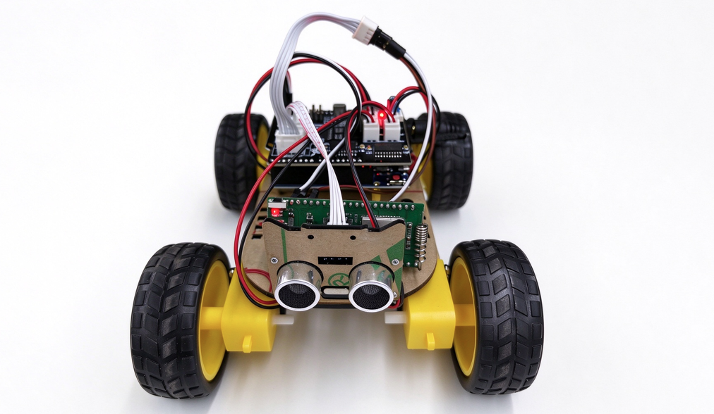

# 智能遥控小车

[English](README.md)

智能遥控小车方案是一个基于UniRTOS构建的蜂窝网络远程控车方案。

本项目以UniRTOS作为端侧运行基础，在移远通信EG800ZCN_LA模组上通过蜂窝网络以MQTT协议接入阿里云物联网平台，接收云端下发的JSON控车指令，并经UART1以单字节指令转发给小车的Arduino UNO主板。UNO固件通过74HCT595移位寄存器和PWM驱动电机，并借助HC-SR04超声波传感器实现自动避障。控车链路基于蜂窝网络，不受蓝牙或Wi-Fi距离限制，可实现远程遥控。

项目附带一个浏览器遥控页面，通过MQTT over WebSocket连接阿里云：按住方向键行驶、松开即停车，并提供自动前进、急停和10档调速功能，同时显示云端连接状态、小车在线状态及带往返时延的指令回执。设备端对运动指令采用确认重发机制，云端链路断开时模组自动停车。本项目可作为蜂窝远程控制、云端指令下发及模组与MCU串口桥接的参考示例。



# 开发资源

| 资源名称 | 数量 | 简要描述 | 获取方法 |
| :--- | :--- | :--- | :--- |
| Pico开发板 | 1 | 项目运行硬件平台，需搭载模组型号“EG800ZCN_LA”。 | [点此购买](https://www.quecmall.com/goods-detail/2c90800b987f06090198aca7bde100a6) |
| Arduino UNO避障小车 | 1套 | 包含Arduino UNO主板、基于74HCT595的电机驱动板、直流电机及HC-SR04超声波传感器。 | [参考链接](https://item.taobao.com/item.htm?id=1030778130041&mi_id=0000RuW-gDmYqmdl1xP_rNbPzhjG1Bqte_7GIh7RXYUYrQs&spm=tbpc.boughtlist.suborder_itemtitle.1.116d2e8dwXaRi6&skuId=6210011631699) |
| 电平转换模块 | 1 | 建议使用。模组UART为3.3V电平，UNO为5V电平。 | 自行准备 |
| 杜邦线 | 若干 | 连接模组UART与UNO串口。 | 自行准备 |
| SIM卡 | 1 | 已开通数据业务、可正常上网的USIM卡，用于MQTT连接。 | 自行准备 |
| USB数据线 | 2 | 一根USB-A转USB-C数据线连接开发板，一根MicroUSB数据线连接UNO，均非“仅充电”类型。 | 自行准备 |
| PC | 1 | Windows 10/Windows 11，用于开发、固件烧录和UNO程序下载。 | 自行准备 |
| 手机或PC浏览器 | 1 | 用于打开遥控页面，建议使用较新版本的Chrome、Edge或Safari。 | 自行准备 |

除硬件外，还需要准备以下软件和云端资源：

| 资源 | 说明 |
| :--- | :--- |
| 阿里云物联网平台实例 | 用于设备认证和消息流转，需记录实例的MQTT接入地址。 |
| Arduino IDE | 用于编译并下载UNO固件[uno_car.ino](uno_fw/uno_car.ino)。 |

# 快速上手

## 硬件连接

模组与UNO通过UART1通信，串口参数为9600波特率、8N1、无流控。按下表接线：

| 模组 | UNO | 说明 |
| :--- | :--- | :--- |
| pin18(UART1 TX) | D(RX) | 模组向UNO发送控车指令。 |
| pin17(UART1 RX) | D1(TX) | UNO回传`CMD:<字节>`确认及调试信息。 |
| GND | GND | 必须共地。 |
| 5 V | 5 V | Pico可通过“5V”标识引脚进行供电，小车运行不通过USB供电时可进行连接，**调试期间请使用USB供电，二者不可同时供电。** |

1. 将SIM卡插入开发板，并接好蜂窝天线。
2. 按上表连接模组与UNO。应用会将模组GPIO电压设置为3.3V，而UNO TX输出5V，因此至少需要在UNO TX → 模组pin17方向加电平转换。
3. 使用USB数据线连接开发板和PC。
4. 小车使用自身电池组供电。

> UNO的D0/D1与其USB串口复用。下载UNO固件前，请先断开模组与D0/D1的连线，下载完成后再接回。

## 软件部署

### 开发环境搭建

参考[UniRTOS快速入门](https://docs.quectel.com/zh/UniRTOS/UniRTOS文档/快速上手/快速上手.html)完成开发环境安装，并确认`unirtos-cli`可在PowerShell中使用。

### 代码拉取

新开启PowerShell窗口，执行以下命令：

```powershell
# 拉取示例仓库
unirtos-cli new -r unirtos-maker-examples
# 进入该项目
cd unirtos-maker-examples/intelligent_rc_car
```

### 配置阿里云

小车和遥控页面作为两个独立设备接入阿里云，由云端在两者之间转发消息。

1. 在阿里云物联网平台控制台创建产品。产品下每个设备默认具有自定义Topic `/${ProductKey}/${DeviceName}/user/update`（发布）和`/${ProductKey}/${DeviceName}/user/get`（订阅）。
2. 在该产品下创建两个设备，例如小车使用`car_dev`，遥控页面使用`web_remote`，并记录各设备的`ProductKey`、`DeviceName`和`DeviceSecret`。
3. 使用物联网平台的消息流转（数据流转）规则，在两个设备之间转发消息：

| 源Topic | 目标Topic | 用途 |
| :--- | :--- | :--- |
| `/${ProductKey}/web_remote/user/update` | `/${ProductKey}/car_dev/user/get` | 将遥控页面的控车指令下发给小车。 |
| `/${ProductKey}/car_dev/user/update` | `/${ProductKey}/web_remote/user/get` | 将小车的回执和状态返回给遥控页面。 |

### 修改配置参数

云端配置集中在[car_cloud_config.h](main/inc/car_cloud_config.h)。编译前需将设备三元组和接入地址替换为自己的值：

```c
#define CAR_CLOUD_SERVER_ADDR          "实例MQTT接入地址"
#define CAR_CLOUD_SERVER_PORT          (1883)
#define CAR_CLOUD_PRODUCT_KEY          "你的ProductKey"
#define CAR_CLOUD_DEVICE_NAME          "car_dev"
#define CAR_CLOUD_DEVICE_SECRET        "小车设备的DeviceSecret"
```

其余配置一般无需修改：

| 配置类别 | 配置项 | 说明 |
| :--- | :--- | :--- |
| MQTT接入地址 | `CAR_CLOUD_SERVER_ADDR`、`CAR_CLOUD_SERVER_PORT` | 使用实例详情页显示的接入地址，例如`iot-xxxx.mqtt.iothub.aliyuncs.com`或`{ProductKey}.iot-as-mqtt.{RegionId}.aliyuncs.com`。设备通过明文TCP端口`1883`连接，使用HMAC-SHA1签名（`securemode=3`）登录。 |
| Topic | `CAR_CLOUD_TOPIC_DOWNLINK`、`CAR_CLOUD_TOPIC_UPLINK` | 由三元组自动拼接，订阅`/user/get`，发布到`/user/update`。 |
| 连接时序 | `CAR_CLOUD_BOOT_DELAY_S`、`CAR_CLOUD_KEEP_ALIVE_S`、`CAR_CLOUD_CONNECT_TIMEOUT_MS`、`CAR_CLOUD_RETRY_DELAY_S` | 默认开机后等待`3 s`驻网，心跳`60 s`，连接超时`60000 ms`，断线`30 s`后重连。 |

### 构建项目

在PowerShell中执行环境配置命令：

```powershell
unirtos-cli env-setup
```

然后执行固件编译命令：

```powershell
unirtos-cli build -m EG800ZCN_LA
```

构建成功后，命令行末尾将显示：

```text
SUCCESS: Unirtos project built successfully!
```

通过QFlash工具将生成的固件烧录至开发板。

### 下载UNO固件

1. 在Arduino IDE中打开[uno_car.ino](uno_fw/uno_car.ino)。
2. 选择**Arduino Uno**开发板及对应串口，上传程序。
3. 上传完成后，将模组连线重新接回UNO的D0/D1。

UNO必须使用该版本固件。它会对每条运动指令回传`CMD:<字节>`，模组据此确认指令已送达。

### 配置遥控页面

1. 在手机或PC浏览器中打开[smallcar_remote.html](remote_control/smallcar_remote.html)，可直接以本地文件方式打开，也可通过HTTP服务访问。
2. 点击右上角齿轮按钮（⚙），填写连接设置：

| 字段 | 说明 |
| :--- | :--- |
| 实例接入地址 | 阿里云实例的MQTT接入地址，与`CAR_CLOUD_SERVER_ADDR`相同。 |
| ProductKey | 产品的ProductKey。 |
| 网页设备 DeviceName | 遥控页面所用设备的DeviceName，例如`web_remote`。 |
| 网页设备 DeviceSecret | 遥控页面所用设备的DeviceSecret。 |
| 小车 DeviceName | 小车设备的DeviceName，例如`car_dev`。 |
| 连接协议 | 推荐使用`ws`，兼容所有浏览器；`wss`为加密连接，但部分浏览器不信任其证书。两者均使用`443`端口。若页面通过HTTPS打开，只能使用`wss`。 |

3. 点击**保存并连接**。配置会保存在浏览器的`localStorage`中；部分手机以本地文件方式打开页面时不支持`localStorage`，下次需重新填写。

### 验证项目

1. 开发板上电，根据[日志调试教程](https://www.quectel.com.cn/unirtos/docs?docs_page=快速上手/日志调试/日志调试.html)使用EPAT抓取日志。
2. 等待模组注册网络并连接云端。出现`[car][cloud][ready] channel is up, waiting downlink commands`日志表示云端通道已就绪。
3. 在遥控页面确认云端状态显示**已连接**；小车上报状态后，小车状态显示**在线**。
4. 按住▲ ▼ ◀ ▶按键分别控制前进、后退、左转和右转，松开按键即停车。
5. 点击**自动前进**，小车向前行驶，遇到20 cm以内的障碍物时后退并左转避让。点击**STOP**或**急停**停车。
6. 点击**加速**或**减速**，以10%为一档调整速度。
7. 页面底部状态栏显示每条指令的回执和往返时延，例如`回执 forward → ok，120 ms`。

不使用遥控页面时，也可以在阿里云控制台小车设备的Topic列表中，直接向`/${ProductKey}/car_dev/user/get`发布指令进行测试。

设备正常运行时，可抓取到类似如下的日志：

```text
[car][app] enter smallcar demo, sdk=...
[car][uart][init] UART1 ready, tx=pin18 rx=pin17 baud=...
[car][cloud][init] channel init done, sub=/<ProductKey>/car_dev/user/get pub=/<ProductKey>/car_dev/user/update
[car][cloud][step0] task started, wait 3s for network
[car][cloud][step1] open <接入地址>:1883
[car][cloud][step2] open event, result=0
[car][cloud][step3] connect event, result=0 code=0
[car][cloud][step5] suback, result=0
[car][cloud][ready] channel is up, waiting downlink commands
[car][app][rx] topic=/<ProductKey>/car_dev/user/get len=... payload={"cmd":"forward","seq":1}
[car][app][cmd] forward -> 'F' ok
[car][uart][tx] 1 byte(s), first='F'(0x46)
[car][uart][ack] 'F' confirmed, retries=0
```

### 项目演示

可参考media/car_work.mp4演示视频。
