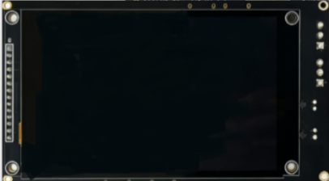
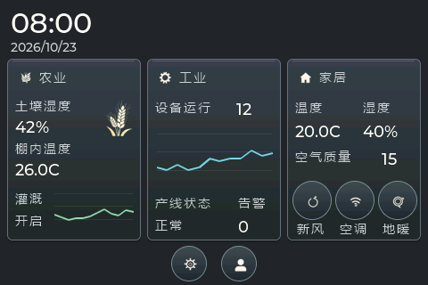
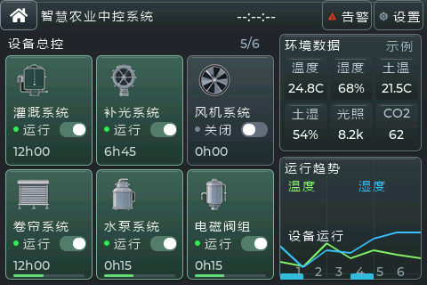
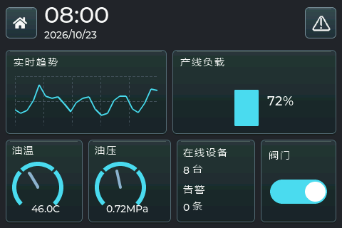
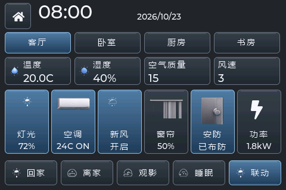

# 大屏网关

[English](README.md)

大屏网关是基于UniRTOS与LVGL构建的多场景触摸交互与设备可视化方案。本项目以UniRTOS作为端侧运行基础，结合LVGL图形框架，在移远EG800ZCN_LA模块上实现ST7796S液晶显示、FT6336电容触摸、首页总览、农业控制面板、工业HMI和智能家居中控等功能。

系统在同一工程内组织首页、农业、工业、家居四个页面，支持场景切换、房间切换、设备状态展示、趋势曲线、仪表显示、滑块调节、告警弹窗和控制确认。

该项目重点展示UniRTOS在图形显示、触摸交互、多场景界面组织、设备状态可视化及业务扩展方面的能力，可作为农业中控屏、轻量工业HMI、智能家居面板和端云协同网关的界面参考。

# 开发资源

| 资源名称 | 数量 | 简要描述 | 获取方法 |
| :--- | :--- | :--- | :--- |
| EG800ZCN_LA 开发平台 | 1 | 运行 UniRTOS 和图形应用，并引出显示、触摸信号。 | 使用项目配套开发板或兼容硬件。 |
| ST7796S 液晶屏 | 1 | 面板原始规格为 320 × 480，工程按 480 × 320 横屏显示。 | 使用项目适配的屏幕。 |
| FT6336 电容触摸组件 | 1 | 通过软件 I2C 读取触点，可与显示屏集成。 | 使用项目适配的触摸组件。 |
| USB 数据线 | 1 | 连接 PC 和开发平台，接口类型以实际开发板为准，不能为仅充电线。 | 自行准备。 |
| PC | 1 | Windows 10 / Windows 11，用于开发、编译、烧录及日志分析。 | 自行准备。 |
| 电源与连接线 | 1 套 | 为模组、屏幕和背光提供符合硬件要求的供电及连接。 | 按开发板、屏幕规格准备。 |
| UniRTOS 开发环境 | 1 套 | 包括 CLI、交叉编译工具链和 SDK。 | 参考下文开发环境搭建。 |
| LCD 功能基础固件包 | 1 份 | 包含本项目所需的 LCD API。 | 使用平台批准、与目标模组和 SDK 匹配的版本。 |
| LTE 天线与可上网 SIM 卡 | 按需 | 后续蜂窝通信、云端接入时使用，本地演示不依赖联网。 | 自行准备。 |
| 传感器、执行器或外部控制设备 | 按需 | 后续农业、工业或家居业务联调时使用。 | 按实际业务选型。 |

# 快速上手

## 硬件连接

将显示屏连接至开发板。



使用USB数据线连接开发板和PC。


当前源码配置的物理引脚如下：

| 模块 | 信号 | 物理引脚 | 说明 |
| :--- | :--- | :--- | :--- |
| LCD | RST | 49 | 显示复位配置引脚。 |
| LCD | DS | 51 | 数据 / 命令选择。 |
| LCD | CS | 52 | 片选。 |
| LCD | DOUT | 50 | 显示数据输出。 |
| LCD | CLK | 53 | 显示时钟。 |
| FT6336 | SDA | 38 | 软件 I2C 数据线。 |
| FT6336 | SCL | 39 | 软件 I2C 时钟线。 |
| FT6336 | RST | 100 | 触摸复位。 |
| FT6336 | INT | 5 | 触摸中断信号引脚，当前采用轮询读取。 |

## 软件部署

### 开发环境搭建

参考 [UniRTOS 快速入门](https://docs.quectel.com/zh/UniRTOS/UniRTOS文档/快速上手/快速上手.html)完成开发环境安装，并确认 `unirtos-cli` 可在 PowerShell 中使用。

### 代码拉取

新开启 PowerShell 窗口，执行以下命令获取对应发布版本的基础工程：

```powershell
unirtos-cli new -r unirtos-maker-examples
cd unirtos-maker-examples/large_screen
```

### 配置参数

本项目尚未将配置集中到单个头文件，主要配置位置如下：

| 配置类别 | 配置位置 | 说明 |
| :--- | :--- | :--- |
| 模组与依赖 | [env_config.json](env_config.json) | 目标模组、SDK 与库依赖。 |
| LCD 引脚、UI 任务、tick | [lvgl_demo.c](main/src/app/lvgl_demo.c) | 显示引脚复用、12 KiB 任务栈、任务优先级和 5 ms tick。 |
| 屏幕驱动 | [lcd_drv_st7796s.c](main/src/drivers/display/lcd_drv_st7796s.c) | ST7796S 初始化、横屏及显示接口参数。 |
| 显示缓冲与输出 | [lvgl_port_display.c](main/src/drivers/display/lvgl_port_display.c) | 480 × 320 分辨率、480 × 40 RGB565 局部缓冲及 flush。 |
| 触摸参数 | [lvgl_touch_ft6336.c](main/src/drivers/touch/lvgl_touch_ft6336.c) | FT6336 地址、软件 I2C 引脚和坐标映射。 |
| 系统功能 | [menuconfig/.config](menuconfig/.config) | 保留 `CONFIG_QOSA_LCD_FUNC=y`。 |
| LVGL 配置 | 外部库的 `include/lv_conf.h` | 64 KiB 堆、RGB565、默认字体、图表和输入采样配置。 |
| 页面公共视觉 | [lvgl_ui_material.h](main/inc/lvgl_ui_material.h) | 渐变、细高光、阴影及按压反馈。 |

### 构建项目

在PowerShell中执行：

```PowerShell
unirtos-cli env-setup
unirtos-cli build -m EG800ZCN_LA
```

构建成功后，命令行将显示：

```Plain
SUCCESS: Unirtos project built successfully!
```

通过QFlash工具将生成的固件烧录至开发板。

### 验证项目

以下图片为真实 LVGL 源码在 Windows 本机测试中生成的 480 × 320 软件渲染预览，并非目标板实拍。英文文档沿用相同预览，不表示设备界面已提供英文版本。

1. 烧录后启动开发板，使用适配平台的日志工具完整抓取启动日志。等待显示初始化完成，确认直接进入首页，没有触摸校准弹窗；检查农业、工业、家居三列概览及底部设置和用户按钮。

   

2. 点击农业标题栏进入农业面板，查看环境指标、趋势及灌溉、补光、风机、卷帘、水泵、阀门六张设备卡片。切换设备开关，打开并关闭告警或设置弹窗，最后点击房屋按钮返回首页。

   

3. 进入工业面板，检查负载趋势、负载柱、油温、油压、在线设备数和告警数量。操作阀门开关，打开并关闭告警弹窗，确认页面恢复后返回首页。

   

4. 进入家居面板，切换客厅、卧室、厨房和书房，操作灯光亮度、空调温度、新风、窗帘和快捷场景，查看功率及安防确认弹窗。再次切换房间，确认各房间状态独立保存；安防控制不等同于真实门锁解锁。

   

5. 检查弹窗遮罩是否阻止触摸穿透，验证屏幕四角和中心的触摸位置。重复场景切换、弹窗开关及滑块操作，检查颜色、渐变、阴影、响应和稳定性。家居滑块在释放时提交控制命令。

