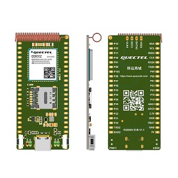
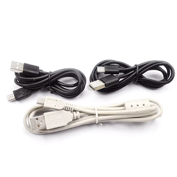

# EG800Z-CN: MQTT Demo
## Project Overview
This project is an MQTT client example developed using Quectel UniRTOS and the QCM MQTT component. After the module powers on, it waits for the cellular network to become ready, then connects to the specified MQTT Broker. It supports topic subscriptions and periodic message publishing, and also enables remote command control via JSON messages. The example uses cJSON to parse incoming commands and can dynamically modify the publishing interval, add or remove subscription topics, and trigger disconnection.
It is suitable for debugging cellular IoT communications and verifying MQTT message exchange flows, and can serve as a basic reference for IoT uplink and downlink messaging. The hardware used is the Quectel EG800Z-CN development board. Logs can be viewed using EPAT.

## Features
MQTT publish/subscribe + JSON remote command parsing example
- MQTT 3.1.1 client: implemented using Quectel’s native `qcm_mqtt` component
- Automatic connection and subscription: automatically subscribes to preset topics after receiving CONNACK upon successful connection
- Periodic publishing timer: automatically starts periodic reporting after subscription succeeds; the reporting interval can be modified by remote command
- JSON remote command control: incoming JSON payloads support 4 commands: modify the publishing interval, add a subscription topic, unsubscribe from a topic, and disconnect the client
- Message-queue event-driven architecture: asynchronous MQTT events are posted to a message queue, decoupling callback context from business logic

```text
Remote command JSON examples:
{"cmd":0,"val_int":10}              // SET_PUB_PERIOD, set reporting interval to 10 seconds
{"cmd":1,"val_int":1,"val_str":"test/demo"} // SET_SUBSCRIBE_TOPIC, subscribe to topic, QoS=1
{"cmd":2,"val_str":"test/demo"}     // SET_UNSUBSCRIBE_TOPIC, unsubscribe from topic
{"cmd":3}                           // DISCONNECT, disconnect MQTT connection
```
## Development Preparation
### Hardware Requirements
- EG800Z-CN development board, [click here to buy the development board](https://www.quecmall.com/goods-detail/2c90800b987f06090198aca7bde100a6).

​   

- USB data cable (TYPE-C), [click here to buy](https://detail.tmall.com/item.htm?abbucket=11&id=712043397690&mi_id=0000UuATUkl2Swill--d8ar3-R828dAfvrmApTj3VzPdxhA&ns=1&priceTId=214783fc17750971433067563e1379&skuId=5825460040081&spm=a21n57.1.hoverItem.4&utparam={"aplus_abtest"%3A"d39c694c59ac1c7b55f24ab87fd2bb30"}&xxc=taobaoSearch)。

​   

- Available SIM card (supports cellular data access and has an active data plan)

### Broker Preparation
Prepare an MQTT server (public test Broker or private Broker). Before compiling, modify the macro definitions in the source code:
- MQTT_DEMO_SERVER_ADDR: Broker address (IP or domain name)
- MQTT_DEMO_SERVER_PORT: MQTT port (default for plaintext is 1883; this demo uses port 47625)


## Quick Start
### 1. Set Up the Development Environment
Refer to the [UNIRTOS Quick Start](https://docs.quectel.com/zh/UniRTOS/UniRTOS文档/快速上手/快速上手.html) documentation to learn how to set up the development environment and complete the basic development workflow.

### 2. Project Structure
```text
mqtt_demo/
├── main
  ├── inc               # Project header files
  └── src               # Project source files
    └── mqtt_demo.c     # Demo source code
├── thirdparty
│   ├── inc             # cJSON header files
│   └── src             # cJSON source files
├── media               # Media files required by the README
├── menucongfig         # Project configuration options
├── CMakeLists.txt      # Demo build script
├── env_config.json     # UniRTOS project environment configuration
└── README.md           # This file
```


### 3. Clone the Code

Open a new PowerShell window and run the following commands:

```
# Clone the example repository
unirtos-cli new -r unirtos-maker-examples
# Enter the project directory
cd unirtos-maker-examples/mqtt_demo
```

### 4. Build the Project

Set up the build environment

```
unirtos-cli env-setup
```

Run the firmware build command in the PowerShell window (if using a module model other than EG800ZCN_LA, replace it with the model you need to build for):

```
unirtos-cli build -m EG800ZCN_LA -v EG800ZCNLAR01A01_OCPU_20260626
```

When the build is complete, the PowerShell window will display the firmware build result at the end:

```text
SUCCESS: Unirtos project built successfully!
```

### 5. Log Output
Flash the firmware, power on the module, and send a subscription to `test/demo`. Example logs:
```text
[mqtt_demo] topic = mqtt_topic_sub, payload_len = 43 
[mqtt_demo] payload = {"cmd":1,"val_int":1,"val_str":"test/demo"} 
[mqtt_demo] publish 
[mqtt_demo] SET_SUBSCRIBE_TOPIC, val_int=1, val_str=test/demo 
```

## Code Overview

### Main Functional Interfaces

### *unir_mqtt_demo_init - Entry and Initialization Function*

- **Function**: Demo entry function. Creates a dedicated background task in which MQTT operations run without blocking the main flow.
- Key operation:
- **Task creation**: Calls qosa_task_create to create a task named mqtt_demo, with unir_mqtt_demo_task as its entry point.

```c
void unir_mqtt_demo_init(void)
{
    int err = 0;
    qosa_task_t mqtt_task = QOSA_NULL;

    err = qosa_task_create(&mqtt_task, MQTT_DEMO_TASK_STACK_SIZE, QOSA_PRIORITY_NORMAL, "mqtt_demo", unir_mqtt_demo_task, QOSA_NULL);
    if (err != QOSA_OK)
    {
        QLOGE("[mqtt_demo] task create error");
        return;
    }
}
```

### *unir_mqtt_demo_task - Main MQTT Task and Event Dispatch*
- **Function**: Main Demo loop. Waits for the cellular network to become ready, initializes the MQTT client, creates a periodic publishing timer, and blocks on the message queue to consume asynchronous MQTT events.
- Key operations:
    - Opens the MQTT client and establishes a TCP connection
    - Event dispatch: open / connect / publish / subscribe / disconnect / receipt of incoming JSON messages, and other events
    - Parses incoming JSON commands to control the timer, subscriptions, and unsubscriptions

## Notes
1. In weak-signal environments, network searching and attachment by the module take longer. If the network is still unavailable after the wait period, activation will fail and communication will not be possible.