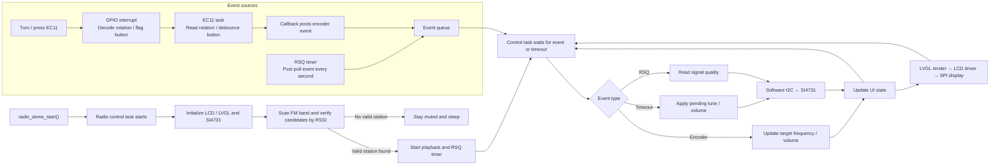
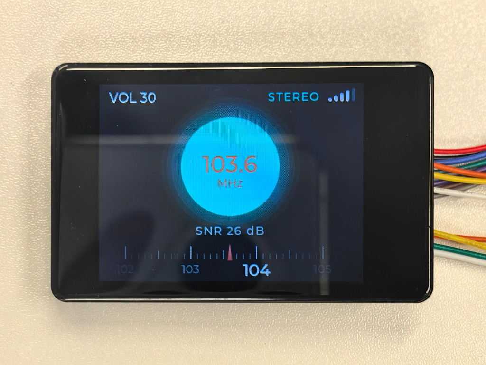
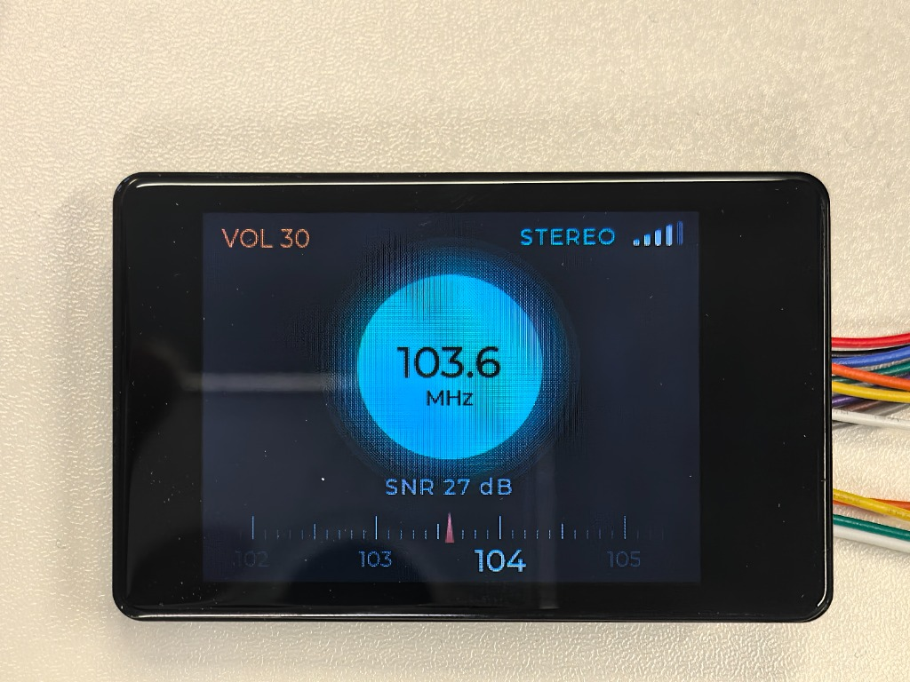

[English](README.md) | [简体中文](README_ZH.md)

# EG800Z-CN: FM Radio Demo

## Project Overview

This UniRTOS external application uses an SI4731 radio module, an EC11 rotary encoder and an ST7789 LCD to build an FM radio. On startup it scans the FM band, selects a station and shows its frequency, volume and signal information on an LVGL dashboard.

## Features

- Control the SI4731 through GPIO-based software I2C; receive FM from 87.50 to 108.00 MHz.
- Scan for stations at startup, sort up to 16 candidates by RSSI and retune to the first one that remains valid. If none is found, the radio stays muted.
- Press the EC11 knob to switch between frequency and volume modes. Each detent changes frequency by 0.1 MHz within 87.5–108.00 MHz, or volume by 1 within 0–63.
- Mute during frequency adjustment and unmute after tuning completes and the knob has been still for at least 300 ms.
- Display the frequency, volume, signal bars, SNR and mono/stereo status on a 320 × 240 landscape LVGL interface.
- Poll the radio signal quality status (RSQ) every second during normal playback.

## Development Preparation

### Hardware Requirements

- Quectel EG800Z-CN Quecduino development board using the `EG800ZCN_LA` module configuration
- SI4731 FM radio module and FM antenna
- EC11 rotary encoder module with a push button
- 2.8-inch ST7789 SPI LCD, physical resolution 240 × 320
- Audio amplifier module, such as PAM8403, and two compatible speakers
- USB data cable, breadboard and jumper wires

### Hardware Connections

The PIN numbers below are **actual physical module pins** according to the development board schematic, not GPIO numbers; do not rely on the board's silkscreen PIN numbers. Connect all grounds together. The software configures the GPIO domain for 3.3 V; ensure that connected signal levels and pull-ups are compatible with 3.3 V. Check each module's power requirements before connecting it.

#### SI4731 Radio Module

| SI4731 module pin | Connection | Description |
| --- | --- | --- |
| ANT | Jumper wire soldered to the antenna pad | Extend the wire as an FM antenna |
| GND | Amplifier audio input ground (⊥) | Common input ground can help reduce noise |
| VCC (both pins) | Development board 3.3 V pin | Connect both VCC pins to 3.3 V |
| RST | Module PIN 25 | Radio reset |
| SCLK / SCL | Module PIN 28 | Software-I2C clock |
| SDIO / SDA | Module PIN 29 | Software-I2C data |
| ROUT | Amplifier R input | Right-channel analog audio output |
| LOUT | Amplifier L input | Left-channel analog audio output |
| /INT | Not connected | Not used by this application |

The code uses the 7-bit I2C address `0x11` (`0x22` write / `0x23` read). The configured write address is `SI4731_WRITE_ADDR` in `main/si4731/si4731.h`. Check the I2C address configuration if using a different module.

#### Audio Amplifier

| Amplifier pin | Connection | Description |
| --- | --- | --- |
| 5V+ | Development board 3.3 V pin | Despite the 5V+ label, this wiring uses a 3.3 V supply |
| 5V- | Development board GND | Amplifier power ground |
| R | SI4731 ROUT | Right-channel analog audio input |
| L | SI4731 LOUT | Left-channel analog audio input |
| ⊥ (audio input ground) | SI4731 GND | Common ground with the radio input |
| L OUT+ | Speaker 0 positive | Left-channel output |
| L OUT- | Speaker 0 negative | Left-channel output |
| R OUT+ | Speaker 1 positive | Right-channel output |
| R OUT- | Speaker 1 negative | Right-channel output |

The amplifier board used here has a level-shifting chip; its 5V+ pin is connected to 3.3 V in this wiring. Check the power requirements of other models. Connect speaker 0 between L OUT+ and L OUT-, and speaker 1 between R OUT+ and R OUT-; do not treat the negative outputs as GND. Keep the audio ground path short to help reduce noise.

#### EC11 Rotary Encoder Module

| EC11 module signal | EG800Z-CN connection | Description |
| --- | --- | --- |
| VCC | Development board 3.3 V pin | Encoder module power |
| GND | GND | Common ground |
| A | Module PIN 20 | Encoder phase A |
| B | Module PIN 21 | Encoder phase B |
| C / button output | Module PIN 19 | Push-button input, active low |

These labels refer to the tested encoder **module**. A bare EC11 may label its common pin `C` and expose separate switch pins; verify the wiring before connecting it.

#### ST7789 LCD

| LCD signal | EG800Z-CN connection | Description |
| --- | --- | --- |
| VCC | Development board 5 V pin | This LCD module board has a level-shifting chip |
| GND | Separate development board GND pin | Common ground with the other modules |
| SCLK / CLK | Module PIN 49 | SPI1 clock |
| MOSI / DIN | Module PIN 63 | SPI1 data |
| CS | Module PIN 64 | Software-controlled chip select |
| DC | Module PIN 67 | Data/command select |
| RST | Module PIN 66 | Display reset |
| BL | Module PIN 62 | PWM0 backlight control |

The 5 V supply above applies to the LCD module shown; check the supply and signal levels when using a different display. Check that the LCD module's BL input accepts a 3.3 V PWM control signal; do not drive a high-current backlight directly from a GPIO pin.

### Software Requirements

- UniRTOS SDK 1.0.5 and the `EG800ZCN_LA` module configuration, as specified in `env_config.json`
- UniRTOS command-line build environment and a supported firmware flashing tool
- EPAT or another supported device log viewer

## Quick Start

### 1. Set Up the Development Environment

Follow the [UniRTOS Quick Start](https://docs.quectel.com/zh/UniRTOS/UniRTOS%E6%96%87%E6%A1%A3/%E5%BF%AB%E9%80%9F%E4%B8%8A%E6%89%8B/%E5%BF%AB%E9%80%9F%E4%B8%8A%E6%89%8B.html) to install the toolchain and prepare the SDK.

### 2. Project Structure

```text
radio_demo/
├── components/
│   ├── lv_conf.h               # LVGL configuration
│   └── lvgl/                   # LVGL 9.2.2 source
├── main/
│   ├── ec11/                   # Encoder and button driver
│   ├── inc/                    # Application and event interfaces
│   ├── radio_ui/
│   │   ├── lcd/                # ST7789 SPI and backlight driver
│   │   ├── radio_ui.c          # LVGL dashboard and display integration
│   │   └── radio_ui.h          # Display state and UI interface
│   ├── si4731/
│   │   ├── i2c/                # GPIO software I2C
│   │   ├── si4731.c            # Radio commands, scan and tuning
│   │   └── si4731.h            # Radio definitions and interface
│   └── src/radio_demo.c        # Tasks, events and radio control
├── media/                      # LCD photos
├── menuconfig/                 # Application configuration
├── CMakeLists.txt              # External-app target and source collection
├── env_config.json             # UniRTOS SDK and module configuration
├── README.md                   # English documentation
└── README_ZH.md                # Chinese documentation
```

### 3. Build the Project

From the project directory, prepare the build environment:

```powershell
unirtos-cli env-setup
```

Build the firmware for the default module. If the locally installed firmware version differs, replace the version number:

```powershell
unirtos-cli build -m EG800ZCN_LA -v EG800ZCNLAR01A01_OCPU_20261126
```

### 4. Run and View Logs

1. With power off, connect the radio module, antenna, encoder, LCD, amplifier and speakers. Verify power and signal levels.
2. Flash the generated application firmware using the supported tool, then power on the board.
3. Wait for the startup scan. The radio remains muted if no candidate can be verified.
4. Rotate the knob to tune; press it to switch to volume mode. Press again to return to frequency mode.

Example log messages are shown below; station and signal values vary by location. The logging system may add timestamps or other fields.

```text
[ec11] EC11 ready: A pin=20 gpio=27, B pin=21 gpio=17, C pin=19, idle AB=11 (expect 11)
[lcd] LCD gpio: cs=12 dc=9 rst=8
[lcd] LCD ready: ST7789 320x240 on SPI1
[radio_ui] LVGL 9.2.2 display ready: 320x240 RGB565, partial buffer=20480 bytes
[radio_ui] LVGL first flush: x=0 y=0 w=320 h=32 format=18
[radio_ui] LVGL initial flushes=8 errors=0
[i2c] Software I2C ready: SCL pin=28 gpio=10 SDA pin=29 gpio=11
[i2c] SDA pull before toggle: 2 (UP=2)
[i2c] SDA pull after dir toggle: 2 (UP=2)
[si4731] SI4731 connected: firmware=4.0 component=6.0 chip=C
[si4731] FM station 89.50 MHz RSSI=47 dBuV SNR=7 dB
[radio_demo] FM playing 89.50 MHz volume=25/63 RSSI=30 dBuV SNR=5 dB
[radio_demo] RSQ Status: valid=0x01 stereo=0 RSSI=44 dBuV SNR=8 dB multipath=0
```

## Code Overview

### Application Workflow

On startup, `radio_demo_start()` creates the event queue and RSQ timer, initializes the encoder and starts the radio control task. The control task initializes the display and SI4731, scans upward from 87.5 MHz, then retunes and verifies candidates in RSSI order. After playback starts, the timer posts an RSQ event every second.



Rotation direction is decoded in the GPIO interrupt, while the EC11 task debounces the button. The timer callback only posts an event to the queue; SI4731 communication and LVGL processing both run in the radio control task, with no separate display task. Audio is muted while tuning and unmuted after tuning completes and the knob has been still for at least 300 ms.

### Main Modules

**Application coordination ([`main/src/radio_demo.c`](main/src/radio_demo.c), [`main/inc/`](main/inc/))**

- **Task and queue creation:** `radio_demo_start()` creates the event queue and RSQ timer, initializes the encoder and starts the radio control task, `radio_task_entry()`. The EC11 has a separate task for processing its interrupts; LVGL runs in the radio control task. The queue message `radio_evt_t` distinguishes encoder and timer events.
- **Startup scan:** The radio task initializes the display and then the SI4731. It calls `si4731_fm_scan()` to search upward from 87.5 MHz and reports the frequency through `radio_scan_progress()` to update the display during the scan. It keeps up to 16 candidates sorted by RSSI, then retunes and checks each candidate's valid flag. Audio is unmuted only after a candidate is confirmed. If there are no candidates or none remain valid, the task stays muted and sleeps.
- **Event handling:** The encoder callback posts rotation and button events to the queue. After playback starts, the timer callback posts a signal-quality polling event to the same queue every second. Both callbacks only post events; the radio task handles them.
- **Encoder handling:** The radio task waits for events with `qosa_msgq_wait()`. Depending on the event, it updates frequency, volume or mode data, and mutes during frequency tuning. After the queue wait times out, the task compares current and target values and applies the latest settings through the SI4731 interface, combining intermediate changes during rapid rotation.
  - In frequency mode, each detent changes the frequency by 0.1 MHz. The range is limited to 87.5–108 MHz without wrapping. Audio is muted on the first tuning step and unmuted once tuning is complete and the knob has been still for at least 300 ms.
  - In volume mode, each detent changes the volume by 1, within 0–63. The default is 25.
- **Signal and UI updates:** On a timer event, the radio task sends a command to read RSQ. The result includes validity, signal strength, SNR and mono/stereo status. `radio_ui_refresh()` collects the target frequency, volume, mode and signal information in a `radio_ui_state_t` for the UI. When events are still queued, it skips intermediate frames where possible to reduce repeated drawing during rapid rotation.

Frequencies in the code use **10 kHz** units: `10360`, for example, means 103.60 MHz. `s_fm_target_freq_10khz` is the frequency requested by the knob; `s_fm_cur_freq_10khz` is the frequency successfully tuned on the chip. Volume also has separate current and target values.

**Radio and software I2C ([`main/si4731/si4731.c`](main/si4731/si4731.c), [`main/si4731/i2c/`](main/si4731/i2c/))**

- `si4731_init()` initializes software I2C, resets the chip and starts FM, configuring analog L/R output, 50 µs de-emphasis, the default volume and mute.
- `si4731_fm_scan()` seeks upward and collects candidates. `si4731_fm_tune()`, `si4731_set_volume()`, `si4731_set_mute()` and `si4731_fm_rsq_status()` handle tuning, volume, mute and signal-quality reads respectively.
- Most chip commands are sent through `si4731_command()`, which then waits for CTS (the command is complete and the chip can accept the next one). Tuning and seeking also wait for STC (operation complete) and read the result.
- `i2c/i2c.c` controls SCL and SDA using GPIO to generate start and stop conditions, transfer addresses and data, and check acknowledgments. It releases the pins and uses pull-ups for a high level; failed transfers return an error and produce a log.

**Encoder ([`main/ec11/ec11.c`](main/ec11/ec11.c), [`main/ec11/ec11.h`](main/ec11/ec11.h))**

- `ec11_init()` configures the A, B and button pins, interrupts and semaphore, and creates the EC11 task.
- A/B transitions invoke `ec11_rotate_isr()`, which decodes direction from the previous and current pin levels, puts valid rotation events in a ring buffer and wakes the EC11 task. The button interrupt only flags an edge and wakes the task; it does not operate the radio or display.
- `ec11_task_start()` waits on the semaphore and consumes rotation events. It debounces the button and reports only a confirmed press. The task passes events to the application through a callback, and the application posts them to the message queue.

**Display ([`main/radio_ui/radio_ui.c`](main/radio_ui/radio_ui.c), [`main/radio_ui/lcd/`](main/radio_ui/lcd/), [`components/lvgl/`](components/lvgl/))**

- `radio_ui_init()` initializes the LCD and LVGL, creates the dashboard and configures the draw buffer. It enables the backlight after the first frame is flushed to reduce random pixels at startup.
- The radio task calls `radio_ui_update()`; `radio_lvgl_update_dashboard()` updates the frequency, volume, status text, signal bars and colors from `radio_ui_state_t`. The bars represent RSSI; after changing stations, mono/stereo status waits for the next RSQ poll.
- `radio_ui_process()` runs the LVGL timer handler. When LVGL needs to flush an area, `radio_lvgl_flush()` calls `lcd_draw()`. The LCD driver sets the drawing window and sends RGB565 pixels over SPI.
- For layout changes, start with `radio_lvgl_make_dashboard()`; for displayed values and mode colors, see `radio_lvgl_update_dashboard()`. `radio_lvgl_draw_scale()` and `radio_lvgl_draw_glow()` draw the ruler and glow. LVGL uses a 32 KiB heap and a 320 × 32-pixel partial draw buffer; check available memory when adding fonts or effects. Configuration is in [`components/lv_conf.h`](components/lv_conf.h).

**Example: tuning the radio**

```text
Turn the knob → GPIO interrupt decodes rotation → EC11 task callback → event queue
              → Radio task updates the target frequency, mutes and refreshes the UI as needed
              → A message wait timeout triggers tuning to the latest target
              → After tuning succeeds and the knob is still for at least 300 ms, unmute
```

Start with `radio_demo_start()` and `radio_task_entry()` for the overall flow, then follow `radio_handle_event_ec11()`, `si4731_fm_tune()` and `radio_ui_refresh()` to see how an operation reaches the chip and updates the screen.

## Actual Display

The landscape screen shows `VOL` at the upper left, signal bars and mono/stereo status at the upper right, frequency and MHz in the center, SNR below, and a frequency ruler at the bottom. In frequency mode the frequency is red-orange; in volume mode `VOL` is red-orange instead.

### Status Indicators

| Status | Description |
| --- | --- |
| `SCANNING` | Startup station scan in progress. |
| `TUNING` | Adjusting the frequency and waiting for tuning to complete. |
| `WAIT RSQ` | Waiting for signal-quality (RSQ) results. |
| `NO SIGNAL` | No valid signal is detected at the current frequency. |
| `STEREO` | Current reception is stereo (two channels). |
| `MONO` | Current reception is mono (one channel). |

### Photos

| Frequency mode | Volume mode |
| --- | --- |
|  |  |

## Notes

- This demo implements **FM only**; AM, RDS and touch input are not implemented.
- If no station is found, check the antenna and reception conditions. The task stays muted and sleeps rather than selecting a fixed fallback station; restart after correcting the problem.
- Signal bars represent RSSI, while SNR indicates signal quality. A valid or strong signal does not necessarily mean noise-free audio; antenna placement, power and grounding also matter.
- For different encoder hardware, adjust `EC11_STEPS_PER_DETENT` or `EC11_REVERSE` consistently in both `main/ec11/ec11.h` and `main/ec11/ec11.c`. Verify pin assignments for the actual board.
