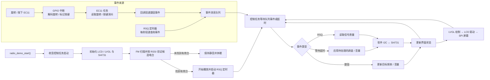
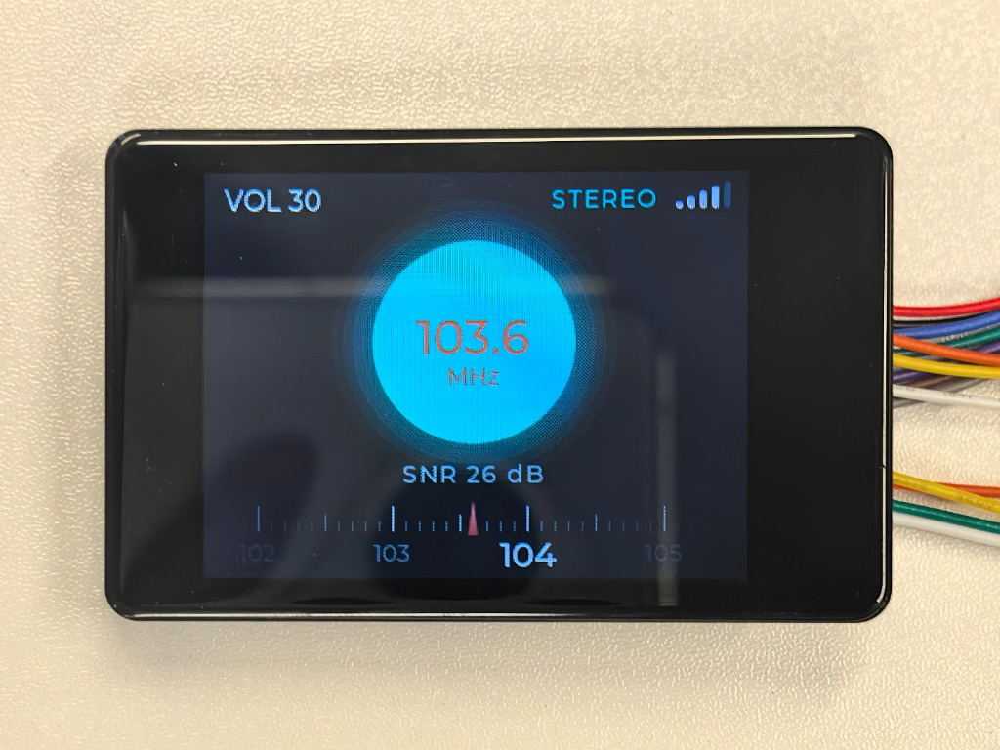
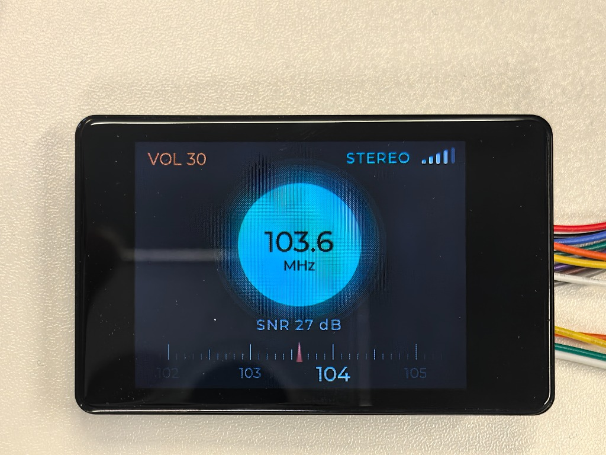

[English](README.md) | [简体中文](README_ZH.md)

# EG800Z-CN：FM 收音机 Demo

## 工程概述

本工程是基于 UniRTOS 的外部应用示例，使用 SI4731 收音模块、EC11 旋钮和 ST7789 LCD 实现 FM 收音机。开机后自动扫描电台并选择可用电台，在界面上显示频率、音量和信号信息。

## 功能特性

- 通过 GPIO 模拟 I2C 控制 SI4731，接收 87.50～108.00 MHz 的 FM 电台。
- 开机扫描电台，最多按 RSSI 保存 16 个候选电台，并依次重新调谐验证；没有可用电台时保持静音。
- 按下 EC11 旋钮切换调频和音量模式；旋转旋钮时，频率每格变化 0.1 MHz，频率范围为87.5~108.00MHz;音量每格变化1，音量范围为 0～63。
- 调频期间静音；调谐完成且旋钮停止至少 300 ms 后解除静音。
- 使用 320 × 240 横屏 LVGL 界面显示频率、音量、信号格、SNR 和单声道/立体声状态。
- 正常播放期间每秒轮询一次信号质量状态（RSQ）。

## 开发准备

### 硬件要求

- 移远 EG800Z-CN 开发板quec duino，模组配置为 `EG800ZCN_LA`
- SI4731 FM 收音模块，配套 FM 天线
- 带按键的 EC11 旋钮模块
- 2.8 英寸 ST7789 SPI LCD，屏幕物理分辨率为 240 × 320
- 音频功放模块（如 PAM8403）及两个匹配的扬声器
- USB 数据线、面包板及若干杜邦线

### 硬件连接

下表中的 PIN 是以开发板原理图为准的**模组实际物理引脚编号**，不是 GPIO 编号，也不要直接以开发板丝印的 PIN 号为准。所有模块需要共地。软件将 GPIO 电压域设置为 3.3 V，请确认外设信号和上拉电压兼容 3.3 V，并在接线前核对各模块的供电要求。

#### SI4731 收音模块

| SI4731 模块引脚 | 接线 | 说明 |
| --- | --- | --- |
| ANT | 天线焊盘焊接杜邦线 | 将杜邦线作为 FM 天线并拉长 |
| GND | 功放音频输入地（⊥） | 收音模块与功放输入共地，有助于减少杂音 |
| VCC（两处） | 开发板 3.3 V 引脚 | 两个 VCC 引脚均接 3.3 V |
| RST | 模组 PIN 25 | 收音模块复位 |
| SCLK / SCL | 模组 PIN 28 | 软件 I2C 时钟 |
| SDIO / SDA | 模组 PIN 29 | 软件 I2C 数据 |
| ROUT | 功放 R 输入 | 右声道模拟音频输出 |
| LOUT | 功放 L 输入 | 左声道模拟音频输出 |
| /INT | 未连接 | 当前工程未使用 |

代码使用 7 位 I2C 地址 `0x11`（写地址 `0x22`，读地址 `0x23`），写地址由 `main/si4731/si4731.h` 中的 `SI4731_WRITE_ADDR` 配置。更换模块时请确认其 I2C 地址配置。

#### 音频功放

| 功放引脚 | 接线 | 说明 |
| --- | --- | --- |
| 5V+ | 开发板 3.3 V 引脚 | 虽然引脚标为 5V+，图中的接法使用 3.3 V 供电 |
| 5V- | 开发板 GND | 功放电源地 |
| R | SI4731 ROUT | 右声道模拟音频输入 |
| L | SI4731 LOUT | 左声道模拟音频输入 |
| ⊥（音频输入地） | SI4731 GND | 收音模块与功放输入共地 |
| L OUT+ | 扬声器 0 正极 | 左声道输出 |
| L OUT- | 扬声器 0 负极 | 左声道输出 |
| R OUT+ | 扬声器 1 正极 | 右声道输出 |
| R OUT- | 扬声器 1 负极 | 右声道输出 |

所用功放板带电平转换芯片；图中的 5V+ 接 3.3 V，其他型号请核对供电规格。扬声器 0 接在 L OUT+ 和 L OUT- 之间，扬声器 1 接在 R OUT+ 和 R OUT- 之间；不要将负输出端当作 GND。音频地线尽量短，有助于减小杂音。

#### EC11 旋钮模块

| EC11 模块信号 | EG800Z-CN 连接 | 说明 |
| --- | --- | --- |
| VCC | 开发板 3.3 V 引脚 | 旋钮模块供电 |
| GND | GND | 共地 |
| A | 模组 PIN 20 | 旋钮 A 相 |
| B | 模组 PIN 21 | 旋钮 B 相 |
| C / 按键输出 | 模组 PIN 19 | 按键输入，按下为低电平 |

这里的标识对应实测的旋钮**模块**。裸 EC11 可能用 `C` 标识公共端，并另外引出按键引脚；接线前请确认实际电路。

#### ST7789 LCD

| LCD 信号 | EG800Z-CN 连接 | 说明 |
| --- | --- | --- |
| VCC | 开发板 5 V 引脚 | 此 LCD 模块板带电平转换芯片 |
| GND | 开发板单独的 GND 引脚 | 与其他模块共地 |
| SCLK / CLK | 模组 PIN 49 | SPI1 时钟 |
| MOSI / DIN | 模组 PIN 63 | SPI1 数据 |
| CS | 模组 PIN 64 | 软件控制片选 |
| DC | 模组 PIN 67 | 数据/命令选择 |
| RST | 模组 PIN 66 | 屏幕复位 |
| BL | 模组 PIN 62 | PWM0 背光控制 |

以上 5 V 供电适用于图中的 LCD 模块板，更换屏幕时请先核对供电和信号电平。请确认 LCD 模块的 BL 输入支持 3.3 V PWM 控制信号，不要用 GPIO 直接驱动大电流背光。

### 软件要求

- UniRTOS SDK 1.0.5 和 `EG800ZCN_LA` 模组配置（见 `env_config.json`）
- 官方 [unirtos-lvgl](https://github.com/UniRTOS/unirtos-lvgl) 库 v1.0.0（LVGL 8.3.11），已在 `env_config.json` 中声明，由 `unirtos-cli env-setup` 自动下载
- UniRTOS 命令行构建环境及受支持的固件烧录工具
- EPAT 或其他受支持的设备日志查看工具

## 快速上手

### 1. 搭建开发环境

参考 [UniRTOS 快速入门](https://docs.quectel.com/zh/UniRTOS/UniRTOS%E6%96%87%E6%A1%A3/%E5%BF%AB%E9%80%9F%E4%B8%8A%E6%89%8B/%E5%BF%AB%E9%80%9F%E4%B8%8A%E6%89%8B.html)，安装工具链并准备 SDK。

### 2. 项目结构

```text
radio_demo/
├── main/
│   ├── ec11/                   # 旋钮及按键驱动
│   ├── inc/                    # 应用及事件接口
│   ├── radio_ui/
│   │   ├── lcd/                # ST7789 SPI 和背光驱动
│   │   ├── radio_ui.c          # LVGL 页面及显示对接
│   │   └── radio_ui.h          # 显示状态及 UI 接口
│   ├── si4731/
│   │   ├── i2c/                # GPIO 模拟 I2C
│   │   ├── si4731.c            # 收音命令、扫描及调谐
│   │   └── si4731.h            # 收音模块定义及接口
│   └── src/radio_demo.c        # 任务、事件与收音控制
├── media/                      # 实物照片
├── menuconfig/                 # 应用配置
├── CMakeLists.txt              # 外部应用目标和源文件收集
├── env_config.json             # UniRTOS SDK、模组和依赖库配置
├── README.md                   # 英文说明
└── README_ZH.md                # 中文说明
```

### 3. 构建项目

在项目目录下准备构建环境：

```powershell
unirtos-cli env-setup
```

该命令会同时把 `env_config.json` 中声明的 LVGL 库下载到 `~/.unirtos/libraries/unirtos-lvgl/v1.0.0/`，本仓库不包含 LVGL 源码。由于 Gitee 镜像的库清单暂未收录 `unirtos-lvgl`，`env_config.json` 通过 `libraries.manifest_repo_url` 指定使用 GitHub 上的清单。

为默认模组构建固件。如本机安装的固件版本不同，请替换版本号：

```powershell
unirtos-cli build -m EG800ZCN_LA -v EG800ZCNLAR01A01_OCPU_20261126
```

### 4. 运行与查看日志

1. 断电连接收音模块、天线、旋钮、LCD、功放和扬声器，检查供电与信号电平。
2. 使用受支持的工具烧录生成的应用固件，然后给开发板上电。
3. 等待开机扫描；如果没有通过验证的电台，收音机会保持静音。
4. 旋转旋钮调整频率；按下旋钮切换到音量模式，再次按下返回调频模式。

日志示例如下，电台及信号数值会随实际位置变化；日志系统还可能附加时间戳等信息：

```text
[ec11] EC11 ready: A pin=20 gpio=27, B pin=21 gpio=17, C pin=19, idle AB=11 (expect 11)  
[lcd] LCD gpio: cs=12 dc=9 rst=8 
[lcd] LCD ready: ST7789 320x240 on SPI1 
[radio_ui] LVGL 8.3.11 display ready: 320x240 RGB565, partial buffer=20480 bytes 
[radio_ui] LVGL first flush: x=0 y=0 w=320 h=32 
[radio_ui] LVGL initial flushes=8 errors=0 
[i2c] Software I2C ready: SCL pin=28 gpio=10 SDA pin=29 gpio=11 
[i2c] SDA pull before toggle: 2 (UP=2) 
[i2c] SDA pull after dir toggle: 2 (UP=2) 
[si4731] SI4731 connected: firmware=4.0 component=6.0 chip=C 
[si4731] FM station 89.50 MHz RSSI=47 dBuV SNR=7 dB 
[radio_demo] FM playing 89.50 MHz volume=25/63 RSSI=30 dBuV SNR=5 dB 
[radio_demo] RSQ Status: valid=0x01 stereo=0 RSSI=44 dBuV SNR=8 dB multipath=0 
```

## 代码概览

### 应用流程

开机后，`radio_demo_start()` 创建事件队列和 RSQ 定时器，初始化旋钮并启动收音控制任务。控制任务初始化屏幕和 SI4731，从 87.5 MHz 开始向上扫描，再按 RSSI 顺序重新调谐并验证候选电台；播放开始后，定时器每秒发送一次 RSQ 事件。



旋转方向由 GPIO 中断解码，按键在 EC11 任务中消抖。定时器回调只向队列投递事件；SI4731 通信和 LVGL 界面处理都由收音控制任务执行，没有独立的显示任务。调频时会先静音，调谐完成且旋钮停止至少 300 ms 后解除静音。

### 主要模块

**应用协调（[`main/src/radio_demo.c`](main/src/radio_demo.c)、[`main/inc/`](main/inc/)）**

- **创建任务和队列**：`radio_demo_start()` 创建事件消息队列和 RSQ 定时器，初始化 EC11，创建收音控制任务 `radio_task_entry()`。EC11 有独立任务用于处理中断回调，LVGL 则在收音控制任务中运行。队列消息 `radio_evt_t` 用于区分旋钮和定时器事件。
- **开机扫描**：收音任务先初始化显示，再初始化 SI4731。随后调用 `si4731_fm_scan()` 从 87.5 MHz 向上搜索，扫描过程中通过 `radio_scan_progress()` 报告频率并刷新界面。程序按 RSSI 从高到低保留最多 16 个候选电台，再逐个重新调谐并检查有效标志；确认有效后才解除静音。没有候选电台或候选电台都未通过验证时，任务保持静音并休眠。
- **接收事件**：旋钮回调将旋转、按键事件放入队列；播放开始后，定时器回调每秒向同一队列发送一次信号质量查询事件。这两个回调只负责投递事件，具体操作由收音任务处理。
- **处理旋钮**：收音任务通过 `qosa_msgq_wait()` 等待事件。根据具体的事件进行频率，音量或者模式的数据更新，调频时执行静音。队列等待超时后，任务比较当前值和目标值，再调用 SI4731 接口应用最新的数据设置，因此连续旋转时可以合并中间设置。
  - 调频时，每格改变 0.1 MHz，频率限制在 87.5～108 MHz，不会在两端循环。首次调频时静音，调谐完成且旋钮停止至少 300 ms 后解除静音。
  - 调音量时，每格改变 1，范围为 0～63。默认音量为 25。
- **更新信号和界面**：收到定时器事件后，收音任务发送指令读取RSQ，返回内容包含是否有效、信号强度、信噪比和单声道/立体声状态。`radio_ui_refresh()` 将目标频率、音量、模式和信号信息整理为 `radio_ui_state_t` 交给 UI；队列中还有事件时会尽量跳过中间帧，减少连续旋转时的重复绘制。

**收音模块与软件 I2C（[`main/si4731/si4731.c`](main/si4731/si4731.c)、[`main/si4731/i2c/`](main/si4731/i2c/)）**

- `si4731_init()` 初始化软件 I2C、复位芯片并启动 FM，配置模拟左右声道输出、50 µs 去加重、默认音量和静音。
- `si4731_fm_scan()` 负责向上寻台并整理候选列表；`si4731_fm_tune()`、`si4731_set_volume()`、`si4731_set_mute()` 和 `si4731_fm_rsq_status()` 分别负责调谐、音量、静音和信号质量读取。
- 大多数芯片命令通过 `si4731_command()` 写入，然后等待 CTS（命令处理完成，芯片可以接收下一条命令）；调谐和寻台还要等待 STC（操作完成）并读取结果。
- `i2c/i2c.c` 用 GPIO 控制 SCL 和 SDA，完成起始、地址和数据传输、应答检查及停止。总线需要高电平时释放引脚并使用上拉，读写失败会返回错误并输出日志。

**旋钮（[`main/ec11/ec11.c`](main/ec11/ec11.c)、[`main/ec11/ec11.h`](main/ec11/ec11.h)）**

- `ec11_init()` 配置 A、B 相和按键引脚、中断及信号量，并创建 EC11 任务。
- A/B 相变化触发 `ec11_rotate_isr()`：根据前后的电平组合判断方向，将有效的旋转事件放入环形缓冲区，并唤醒 EC11 任务。按键中断只标记边沿并唤醒任务，不在中断里处理收音或显示。
- `ec11_task_start()` 等待信号量，读取旋转事件；按键经消抖后，只在确认按下时上报。任务通过回调把事件交给应用，再由应用放入消息队列。

**显示（[`main/radio_ui/radio_ui.c`](main/radio_ui/radio_ui.c)、[`main/radio_ui/lcd/`](main/radio_ui/lcd/)、[unirtos-lvgl](https://github.com/UniRTOS/unirtos-lvgl)）**

- `radio_ui_init()` 初始化 LCD 和 LVGL，创建页面、配置绘图缓冲区；首帧刷新后再打开背光，减少上电时显示随机画面。
- 收音任务调用 `radio_ui_update()`，由 `radio_lvgl_update_dashboard()` 根据 `radio_ui_state_t` 更新频率、音量、状态文字、信号格和颜色。信号格表示 RSSI；切台后单声道/立体声状态要等下一次 RSQ 查询。
- `radio_ui_process()` 调用 LVGL 的定时处理函数。LVGL 需要刷新区域时，通过 `radio_lvgl_flush()` 调用 `lcd_draw()`；LCD 驱动设置屏幕绘制区域，再通过 SPI 发送 RGB565 像素。
- 修改界面布局时先看 `radio_lvgl_make_dashboard()`；修改显示内容和模式颜色时看 `radio_lvgl_update_dashboard()`；刻度尺和光晕分别由 `radio_lvgl_draw_scale()` 和 `radio_lvgl_draw_glow()` 绘制。LVGL 堆内存为 48 KiB，局部绘图缓冲区为 320 × 32 像素；增加字体或特效时请留意内存。官方配置只启用了 Montserrat 14/16，Montserrat 20/24/28 由应用的 `CMakeLists.txt` 自行编译。配置位于库中的 `include/lv_conf.h`。

**一次调频过程**

```text
旋转旋钮 → GPIO 中断解码 → EC11 任务回调 → 事件消息队列
         → 收音任务更新目标频率并静音，按需刷新界面
         → 等待消息超时后调谐到最新目标频率
         → 调谐成功且旋钮停止至少 300 ms 后解除静音
```

## 实物显示效果

横屏界面左上角显示 `VOL`，右上角显示信号格及状态，中央显示频率和 MHz，下方显示 SNR，底部是频率刻度。调频模式下频率为红橙色；音量模式下则由 `VOL` 变为红橙色。

### 状态文字说明

| 状态文字 | 说明 |
| --- | --- |
| `SCANNING` | 正处于开机扫描电台的流程。 |
| `TUNING` | 正在调节频率，等待调谐完成。 |
| `WAIT RSQ` | 等待信号质量（RSQ）结果。 |
| `NO SIGNAL` | 当前频率未检测到有效电台信号。 |
| `STEREO` | 当前接收到立体声信号（双声道）。 |
| `MONO` | 当前接收到单声道信号。 |

### 实物照片

| 调频模式 | 音量模式 |
| --- | --- |
|  |  |

## 注意事项

- 当前工程**只实现 FM**，未实现 AM、RDS 和触摸输入。
- 如果扫描不到电台，请检查天线和接收环境。任务会保持静音并休眠，不会自动选择固定频率；排查后请重新启动。
- 信号格反映 RSSI，SNR 反映信号质量。电台有效或信号较强不代表一定没有杂音，天线位置、供电和接地也会影响音质。
- 更换旋钮型号时，可在 `main/ec11/ec11.h` 和 `main/ec11/ec11.c` 中同步调整 `EC11_STEPS_PER_DETENT` 或 `EC11_REVERSE`；请按实际开发板确认引脚。
