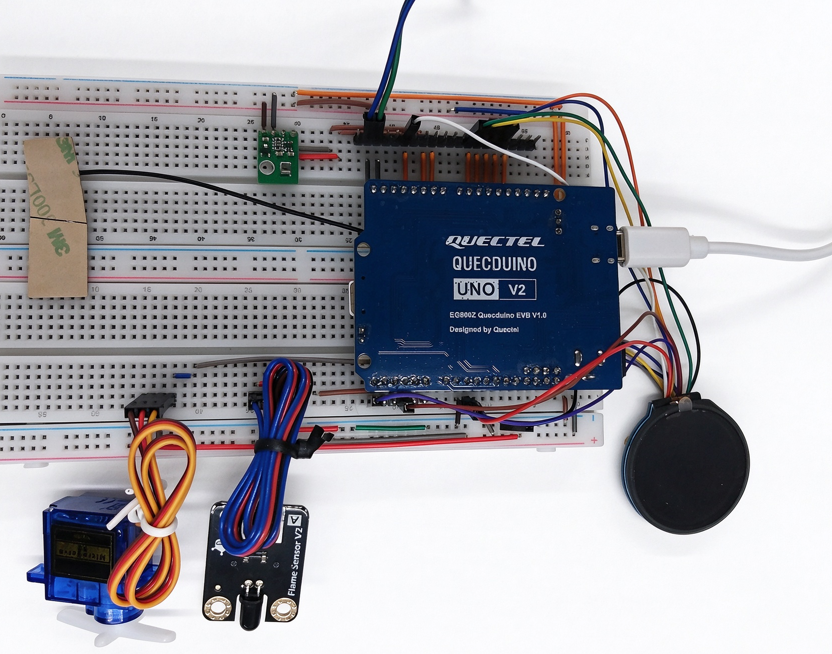
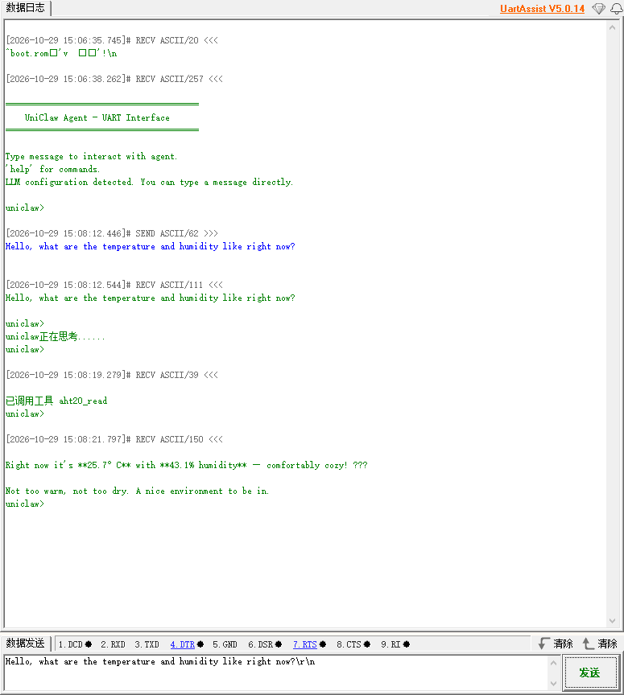
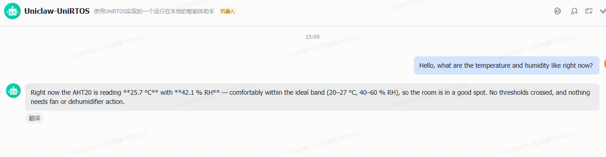

# UniClaw Edge AI Agent

## Overview

The UniClaw Edge AI Agent is an edge-side, multi-channel LLM agent solution built on UniRTOS.

Using UniRTOS as its edge runtime, this project combines LLM-based conversation and reasoning, ReAct tool calls, multi-channel access, and direct control of edge hardware. It runs on the Quectel EG800ZCN_LA module to provide natural-language interaction, task orchestration, and device control. The system currently supports Feishu and serial interfaces. After receiving a user message, the Agent autonomously performs the loop “understand → call a tool → read the result → continue reasoning.” During a conversation, it can call edge-side tools for file management, scheduled tasks, web searches, long-term memory, temperature and humidity readings, flame detection, and display and servo control. The solution is also extensible: users can add edge-side tools, switch LLM providers, or integrate new interaction channels.

This project demonstrates UniRTOS capabilities in LLM-based conversation and reasoning, tool-call orchestration, multi-channel access, edge-side environmental sensing and device control, deployment across Quectel modules, and feature extensibility. It can serve as a reference example for edge AI agents, intelligent interactive terminals, and edge-cloud collaboration systems.



## Development Resources

| **Resource** | **Quantity** | **Description** | **How to Obtain** |
| :--- | :--- | :--- | :--- |
| QuecDuino development board | 1 | Project hardware platform. Must be equipped with an “EG800ZCN_LA” module. | [Purchase here](https://www.quecmall.com/goods-detail/2c90800b9e4a2da8019e71fa2b3000df) |
| USB cable | 1 | Connects the PC to the development board. Use a USB-A-to-USB-C cable that supports data transfer, not charging only. | [Purchase here](https://detail.tmall.com/item.htm?ali_refid=a3_430673_1006%3A1103572855%3AH%3AiN3MzxVVXOSPAWKJATalEI8iKmKqJtEV%3Aeb029f7aacc91614af019d5af9cf8eb7&ali_trackid=282_eb029f7aacc91614af019d5af9cf8eb7&id=792907708735&loginBonus=1&mi_id=0000OnGii6VAwboncMLNvxgujyzZSTVWPKVNZ10CzkTIBXU&mm_sceneid=1_0_27850903_0&priceTId=213e09ef17885029529444013e11cc&skuId=6073745560170&spm=a21n57.sem.item.2&utparam={"aplus_abtest"%3A"80d921898feda47009cd32ee6352cefe"}&xxc=ad_ztc) |
| PC | 1 | Windows 10 or Windows 11. | Provide your own |
| SIM card | 1 | A USIM card with working internet access. | Provide your own |
| AHT20 sensor | 1 | Optional; used for temperature and humidity readings and environmental alerts. | [Purchase here](https://detail.tmall.com/item.htm?ali_refid=a3_430673_1006%3A1235000100%3AH%3AhJoOXfalF2oe8k12FLw11g%3D%3D%3Ac5297d185d6485779a651f8b3f7bfc12&ali_trackid=282_c5297d185d6485779a651f8b3f7bfc12&id=660112460489&loginBonus=1&mi_id=00005HfUnWmcJDtQG5ic0V5zRWr-rjueqORl_Jsq8_FfHR4&mm_sceneid=1_0_463550171_0_0&priceTId=2147843217921448372585943e0f3e&skuId=5065407290624&spm=a21n57.sem.item.45&utparam={"aplus_abtest"%3A"410d0e283777041d9d33a178809be62c"}&xxc=ad_ztc) |
| KY-026 flame sensor | 1 | Optional; used for flame detection and fire alerts. | [Purchase here](https://item.taobao.com/item.htm?ali_refid=a3_430673_1006%3A1102592138%3AN%3AurOf1HF32NNhy0CL%2F5xHV9laW7nnE8LJ%3A6f8c1f5409f02706fa3483e9c67779a4&ali_trackid=1_6f8c1f5409f02706fa3483e9c67779a4&id=19271905330&loginBonus=1&mi_id=0000--hJQBh7nQUHZWEJV9krxk2-piI7GF1xpXBo6NS7z6g&mm_sceneid=1_0_10672050_0_0&priceTId=2147843217921448689327073e0f3e&spm=a21n57.sem.item.4&utparam={"aplus_abtest"%3A"146deb4a4840c8ed8f104517df1e47c5"}&xxc=ad_ztc) |
| SG90 servo | 1 | Optional; used to demonstrate servo control. | [Purchase here](https://detail.tmall.com/item.htm?ali_refid=a3_430673_1006%3A1303560141%3AN%3Ag7s78nHHCINeVmWDJsWEb72Ozm4nW%2FMy%3A1de675c8c448f0065f40c7d89d9999fc&ali_trackid=1_1de675c8c448f0065f40c7d89d9999fc&id=678498890304&loginBonus=1&mi_id=0000DsHqjuYiR_DbDcuAm1PThj4IORsEtJdicMSWSsg4Hb8&mm_sceneid=1_0_727720075_0_0&priceTId=2147843217921447979754378e0f3e&skuId=5719859296396&spm=a21n57.sem.item.1&utparam={"aplus_abtest"%3A"8f2747da532f23d72b3e495cb81debc7"}&xxc=ad_ztc) |
| Round display | 1 | Optional. Waveshare 1.28-inch round display, 240 × 240 pixels, GC9A01 driver; used for animations and status display. | [Purchase here](https://www.waveshare.net/shop/1.28inch-Touch-LCD.htm) |
| Serial module | 1 | Required; used for serial text interaction and setting sensitive information such as Feishu and Coze platform credentials. | Provide your own |

## Quick Start

### Hardware Connections

- Attach the LTE antenna to the antenna connector on the development board.
- Insert the SIM card into the SIM card slot.
- Connect the development board to the PC using the USB cable.
- (Optional) Connect the AHT20 sensor's SCL to Pin 29 and SDA to Pin 28 for temperature and humidity readings.
- (Optional) Connect the KY-026 flame sensor's analog output (AO) to ADC1 for flame detection.
- (Optional) Connect the Waveshare 1.28-inch round display to SPI1: CS to Pin 64, MOSI to Pin 63, MISO to Pin 62, SCLK to Pin 49, RST to Pin 22, DC to Pin 23, and BL to Pin 19. Connect the 3.3 V power supply and GND as well. Touch is disabled by default, so the touch pins do not need to be connected.
- Connect the serial module's RX to the development board's TX (Pin 18), and TX to the board's RX (Pin 17), for serial text interaction.

### Software Deployment

#### Flash the Firmware

Download the firmware and use QFlash to flash the generated firmware to the development board.

#### Update Configuration Parameters

After flashing, you can also use the serial **config** command to update cloud account settings and channel toggles at runtime.

| **Configuration Category** | **Configuration Item** | **Description** |
| :--- | :--- | :--- |
| LLM provider | *llm.provider* | LLM provider. Options are qwen, openai, or anthropic; the default is qwen. |
| LLM credentials | *llm.api_key*, *llm.model* | Set the access key and model name, respectively. The key is sensitive information; you must use your own valid key. |
| Feishu integration | *channels.feishu.app_id*, *channels.feishu.app_secret* | Set the Feishu application's App ID and App Secret, respectively. |
| Feishu toggle | *channels.feishu.enabled* | Enables or disables the Feishu channel; set to true or false. |

#### Configuration Example

After flashing, run the following commands in order in a serial terminal (UART1, 115200 bps) to configure the account. Each command is saved automatically and persists after reboot.

```Plain
config set llm.provider qwen
config set llm.model qwen3.8-flash
config set llm.api_key sk-xxxxxxxxxxxxxxxx
config set channels.feishu.app_id cli_xxxxxxxxxxxxxxxx
config set channels.feishu.app_secret xxxxxxxxxxxxxxxx
```

After running each command, use **config get** to verify the value:

```Plain
config get llm.provider
config get channels.feishu.app_id
```

Enter **config help** to view all configurable items, or **help** to view the serial command list. Feishu credentials take effect immediately without a reboot.

#### Verify the Project

- Press and hold the development board's power button (S1) to turn it on. Open EPAT and configure it according to the [Log Debugging Tutorial](https://www.quectel.com.cn/unirtos/docs?docs_page=快速上手/日志调试/日志调试.html). After configuration, reboot the board and capture module logs starting from power-on to ensure the output is complete.
- Wait for initialization to finish, then confirm in EPAT that the Agent has started.
- Send a line of text over serial to chat with the Agent, or message the bot in the Feishu app. The Agent calls edge-side tools as needed and returns the results.

## Solution Features

### Functional Architecture

The solution is organized into five layers:

- Interaction layer: Integrates Feishu and serial interfaces, converting external messages into Agent input.
- Decision layer: Maintains the Agent's conversation and tool-calling loop, understands intent, selects tools, and generates responses. This is the business decision center.
- Capability layer: Provides shared capabilities such as LLM integration, tool registration and dispatch, long-term memory, session management, scheduled tasks, and skill loading.
- Connectivity layer: Provides a unified wrapper for HTTP/HTTPS and WebSocket access, hiding underlying network differences from the capability layer.
- Adaptation layer: Interfaces with UniRTOS threads, locks, time, files, logging, networking, and audio APIs to support migration across modules.

The layers are decoupled through a message queue: the interaction layer only enqueues low-frequency control messages, while the decision layer processes them sequentially and sends responses back. LLM requests and tool execution take place within the decision layer and do not occupy the control queue, so real-time interaction is not blocked by long-running requests.

### Multi-Channel Access

- Feishu: Receives events over a persistent WebSocket connection and replies through HTTP APIs, supporting natural-language conversations in both group and direct chats.
- Serial: Sends and receives text one line at a time. It supports both local configuration commands and free-form conversations with the Agent, making it useful when there is no network connection or during on-site debugging.

Channels can be enabled independently as needed. They do not interfere with each other, and the remaining channels continue to work if one channel fails.

### Conversation and Tool Calls

When the Agent receives a user message, it first interprets the intent based on its role, skill documents, and conversation history, then decides whether to call an edge-side tool. If external information or a device action is needed, the Agent issues a tool call, reads the execution result, and continues reasoning based on that result. This loop continues until it can provide a final answer, with a maximum of 10 iterations per conversation turn.

To ensure reliable operation on resource-constrained modules, the solution limits context length and request body size. System prompts are truncated at a fixed limit, conversation history is trimmed to fit the request budget, and individual responses are length-limited to prevent accumulated conversation history from causing server-side rejections.

### Edge-Side Tools

Tools are managed through a registry. Their names, descriptions, and parameter schemas are exposed to the model. When the Agent calls a tool by name, the device executes it locally and returns a structured result. Built-in capabilities include:

| **Capability** | **Description** |
| :--- | :--- |
| File management | Reads, writes, edits, and lists files in the data directory for configuration persistence, content generation, and log archiving. |
| Scheduled tasks | Creates, queries, and deletes periodic or scheduled tasks for reminders, periodic data collection, and automatic reporting. |
| Web search | Searches current online information to answer time-sensitive questions and retrieve news and external resources. |
| Long-term memory | Saves, appends, reads, and clears memory so the Agent can maintain context across multiple turns and sessions. |
| Temperature and humidity sensing | Reads temperature, humidity, and comfort level from the AHT20 for environmental queries and comfort assessments. |
| Flame detection | Reads the KY-026 and returns a safe, risk, or alarm status with recent sampling trends for fire-risk assessment. |
| Display and motion control | Optionally controls the round display and its animations, stepper motors and servo angles, and matrix lighting effects. |

To add a tool, provide its name, description, parameter schema, and local execution logic, then register it. The conversation flow, message bus, and network integrations do not need to change, making it easy to tailor or extend capabilities for specific industries.

### Edge-Side Environmental Monitoring and Alerts

The solution periodically samples temperature, humidity, and flame status in the background, and caches the most recent valid readings for the Agent to query. This avoids frequent hardware access during conversations. When the temperature exceeds 30 °C, humidity exceeds 90%, or a flame is detected, the device generates an alert event for the Agent to process and sends a natural-language notification to the user.

Environmental alerts and flame alerts have independent 5-minute cooldown windows to avoid repeatedly notifying users about the same issue. Flame status is divided into three voltage-based levels—safe, risk, and alarm—to distinguish potential hazards from open flames.

### Runtime Notes

- Cellular data is activated before network access. The first interaction may take several seconds.
- Cloud keys, tokens, contact information, and other credentials are sensitive. Replace the examples with your own valid credentials and store them securely.
- If an optional peripheral is disconnected or misconfigured, its corresponding capability is degraded automatically. The device can still converse through the remaining channels.

## Demo

Use the serial **config** command to set configuration values. Changes take effect immediately without reflashing.

Connect a PC serial terminal to UART1, set the baud rate to 115200 bps, and run the following commands in order to configure the cloud account. Each command is saved automatically and persists after reboot.

```Plain
config set llm.provider qwen
config set llm.model qwen3.8-flash
config set llm.api_key sk-xxxxxxxxxxxxxxxx
config set channels.feishu.app_id cli_xxxxxxxxxxxxxxxx
config set channels.feishu.app_secret xxxxxxxxxxxxxxxx
```

### Power On

Press and hold button S1 on the development board. The power indicator will turn on to show that the module is powered up. The application is ready when the Agent initialization log appears.


### Display

After initialization, the round display shows a default animation that moves back and forth across the screen. Try commands such as “turn on the display,” “turn off the display,” “pause the animation,” and “resume the animation” to test display and animation control. Turning off the display also turns off the backlight; both resume when it is turned on again.


### Serial Conversation

Open a serial terminal on UART1 (115200 bps) and send a line of text to ask the Agent a question. After reasoning, the Agent prints its response to the terminal. For example, if you ask “What is the indoor temperature now?”, the Agent reads the AHT20 and returns the temperature and humidity.



### Feishu Conversation

Send a message to the configured bot in the Feishu app. The Agent processes the event and replies. You can ask the Agent to create a scheduled task, search the web, or read sensor status to verify edge-side tool calls and multi-turn context.



### Environmental Alerts

When the temperature or humidity exceeds its threshold, or a flame is detected, the device sends an alert event to the Agent. The Agent generates a notification and sends it to the user through the active channel, enabling unattended environmental monitoring.

## Community & Support

- [UniRTOS Community](https://forumschinese.quectel.com/c/66-category/66): Ask questions and share projects in the official forum (Chinese).
- [Quectel Forums](https://forums.quectel.com/): Discuss Quectel modules in English.
- [Report an Issue](https://github.com/UniRTOS/unirtos-maker-examples/issues): Report code or documentation problems with reproduction steps.
- [Contribute a Fix or Example](https://github.com/UniRTOS/unirtos-maker-examples/pulls): Submit a pull request with a summary and verification results.