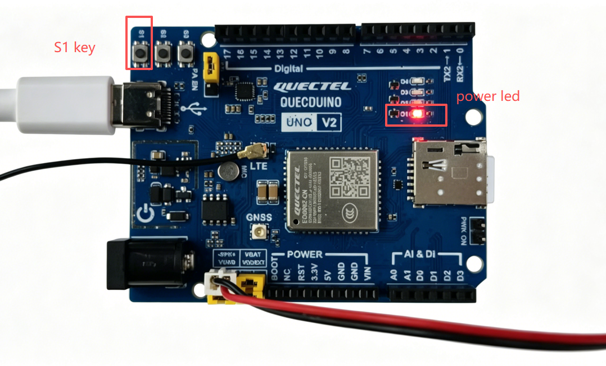
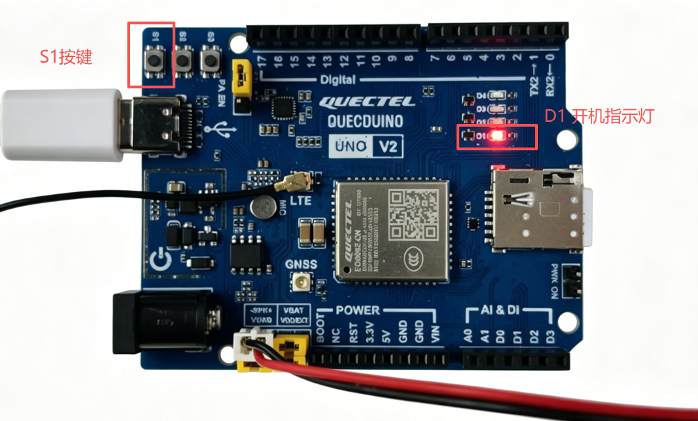
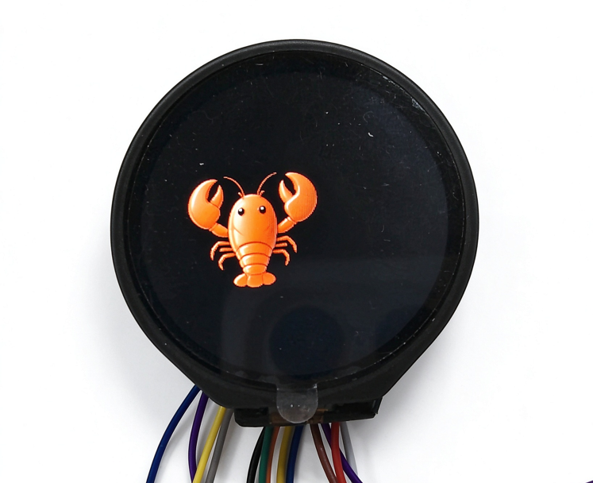
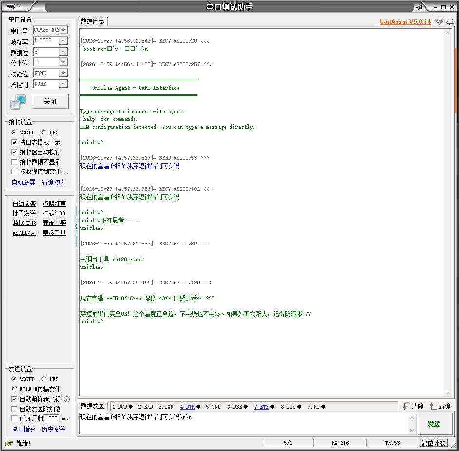
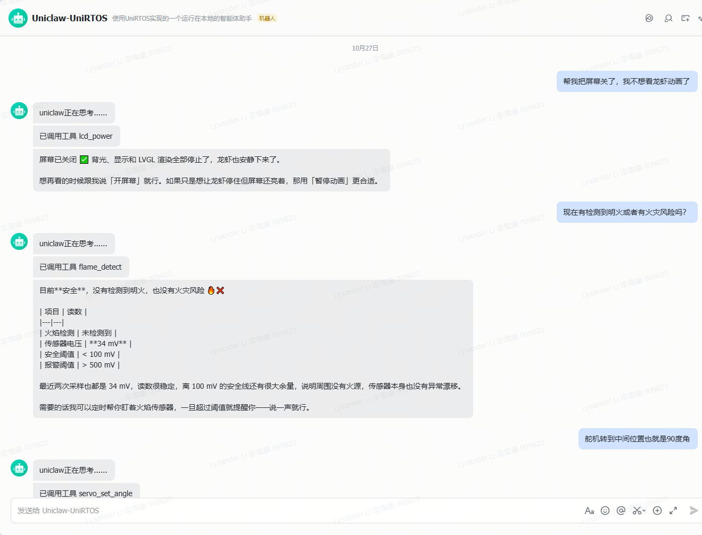

# UniClaw端侧AI智能体

## 项目概述

UniClaw端侧AI智能体方案是一个基于UniRTOS构建的端侧多通道LLM AI Agent方案。

本项目以UniRTOS作为端侧运行基础，结合大模型对话推理、ReAct工具调用、多渠道接入和端侧硬件直控，在移远EG800ZCN_LA模块上实现自然语言交互、任务编排与设备控制。系统目前支持飞书和串口两种交互方式，接收用户消息后由Agent自主完成“理解→调用工具→读取结果→继续推理”的循环，并可在对话过程中调用端侧工具，例如文件管理、定时任务、网络检索、长期记忆、温湿度读取、火焰检测以及屏幕与舵机控制；同时支持灵活扩展，用户可自行新增端侧工具、切换大模型服务商或接入新的交互通道。

该项目重点展示UniRTOS在大模型对话推理、工具调用编排、多通道接入、端侧环境感知与设备控制、跨移远模组部署和功能扩展方面的能力，可作为端侧AI Agent、智能交互终端和端云协同系统的参考示例。



## 开发资源

| **资源名称**     | **数量** | **简要描述**                                                 | **获取方法**                                                 |
| :--------------- | :------- | :----------------------------------------------------------- | :----------------------------------------------------------- |
| QuecDuino开发板  | 1        | 项目运行硬件平台，需搭载模块型号“EG800ZCN_LA”。              | [点此购买](https://www.quecmall.com/goods-detail/2c90800b9e4a2da8019e71fa2b3000df) |
| USB数据线        | 1        | 用于连接PC和开发板，非“仅充电”类型的USB-A转USB-C。           | [点此购买](https://detail.tmall.com/item.htm?ali_refid=a3_430673_1006%3A1103572855%3AH%3AiN3MzxVVXOSPAWKJATalEI8iKmKqJtEV%3Aeb029f7aacc91614af019d5af9cf8eb7&ali_trackid=282_eb029f7aacc91614af019d5af9cf8eb7&id=792907708735&loginBonus=1&mi_id=0000OnGii6VAwboncMLNvxgujyzZSTVWPKVNZ10CzkTIBXU&mm_sceneid=1_0_27850903_0&priceTId=213e09ef17885029529444013e11cc&skuId=6073745560170&spm=a21n57.sem.item.2&utparam={"aplus_abtest"%3A"80d921898feda47009cd32ee6352cefe"}&xxc=ad_ztc) |
| PC               | 1        | 系统为Windows 10/Windows 11。                                | 自行准备                                                     |
| SIM卡            | 1        | 可正常上网的USIM卡。                                         | 自行准备                                                     |
| AHT20传感器      | 1        | 可选，用于温湿度读取与环境告警。                             | [点此购买](https://detail.tmall.com/item.htm?ali_refid=a3_430673_1006%3A1235000100%3AH%3AhJoOXfalF2oe8k12FLw11g%3D%3D%3Ac5297d185d6485779a651f8b3f7bfc12&ali_trackid=282_c5297d185d6485779a651f8b3f7bfc12&id=660112460489&loginBonus=1&mi_id=00005HfUnWmcJDtQG5ic0V5zRWr-rjueqORl_Jsq8_FfHR4&mm_sceneid=1_0_463550171_0_0&priceTId=2147843217921448372585943e0f3e&skuId=5065407290624&spm=a21n57.sem.item.45&utparam={"aplus_abtest"%3A"410d0e283777041d9d33a178809be62c"}&xxc=ad_ztc) |
| KY-026火焰传感器 | 1        | 可选，用于火焰检测与火情告警。                               | [点此购买](https://item.taobao.com/item.htm?ali_refid=a3_430673_1006%3A1102592138%3AN%3AurOf1HF32NNhy0CL%2F5xHV9laW7nnE8LJ%3A6f8c1f5409f02706fa3483e9c67779a4&ali_trackid=1_6f8c1f5409f02706fa3483e9c67779a4&id=19271905330&loginBonus=1&mi_id=0000--hJQBh7nQUHZWEJV9krxk2-piI7GF1xpXBo6NS7z6g&mm_sceneid=1_0_10672050_0_0&priceTId=2147843217921448689327073e0f3e&spm=a21n57.sem.item.4&utparam={"aplus_abtest"%3A"146deb4a4840c8ed8f104517df1e47c5"}&xxc=ad_ztc) |
| sg90舵机         | 1        | 可选，用于演示驱动舵机功能。                                 | [点此购买](https://detail.tmall.com/item.htm?ali_refid=a3_430673_1006%3A1303560141%3AN%3Ag7s78nHHCINeVmWDJsWEb72Ozm4nW%2FMy%3A1de675c8c448f0065f40c7d89d9999fc&ali_trackid=1_1de675c8c448f0065f40c7d89d9999fc&id=678498890304&loginBonus=1&mi_id=0000DsHqjuYiR_DbDcuAm1PThj4IORsEtJdicMSWSsg4Hb8&mm_sceneid=1_0_727720075_0_0&priceTId=2147843217921447979754378e0f3e&skuId=5719859296396&spm=a21n57.sem.item.1&utparam={"aplus_abtest"%3A"8f2747da532f23d72b3e495cb81debc7"}&xxc=ad_ztc) |
| 圆形显示屏       | 1        | 可选，微雪 1.28 英寸圆形显示屏，分辨率 240*240 像素，驱动芯片GC9A01，用于动画与状态显示。 | [点此购买](https://www.waveshare.net/shop/1.28inch-Touch-LCD.htm) |
| 串口模块         | 1        | 必选，用于串口文本交互、设置飞书、Coze平台秘钥等敏感信息。   | 自行准备                                                     |

## 快速上手

### 硬件连接

- 将LTE天线安装到开发板的天线底座。
- 将SIM卡插入SIM卡卡槽。
- 使用USB数据线连接开发板和PC。
- （可选）将AHT20传感器的SCL接入Pin29、SDA接入Pin28，用于温湿度读取。
- （可选）将KY-026火焰传感器的模拟输出AO接入ADC1，用于火焰检测。
- （可选）将微雪 1.28 英寸圆形显示屏接入SPI1：CS接Pin64、MOSI接Pin63、MISO接Pin62、SCLK接Pin49，RST接Pin22、DC接Pin23、BL接Pin19，并连接3.3 V电源与GND。触摸功能默认关闭，无需连接触摸引脚。
- 将串口模块的RX接开发板TX(Pin 18)、TX接开发板RX(Pin 17)，用于串口文本交互。

### 软件部署

#### 烧录固件

下载固件，通过QFlash工具将生成的固件烧录至开发板。

#### 修改配置参数

烧录完成后，也可通过串口交互的**config**命令在运行期修改云端账号与通道开关。

| **配置类别** | **配置项**                                             | **说明**                                                     |
| :----------- | :----------------------------------------------------- | :----------------------------------------------------------- |
| 大模型服务商 | *llm.provider*                                         | 大模型服务商，可选qwen、openai或anthropic，当前默认为qwen。  |
| 大模型密钥   | *llm.api_key*、*llm.model*                             | 分别配置访问密钥和模型名称。密钥属于敏感信息，必须使用自己的有效密钥。 |
| 飞书接入     | *channels.feishu.app_id*、*channels.feishu.app_secret* | 分别配置飞书应用的App ID和App Secret。                       |
| 飞书开关     | *channels.feishu.enabled*                              | 飞书通道使能，取值为true或false。                            |

#### 配置示例

烧录完成后，通过串口终端（UART1、115200 bps）依次执行以下命令写入账号信息。命令执行后自动保存，重启后不再丢失。

```Plain
config set llm.provider qwen
config set llm.model qwen3.8-flash
config set llm.api_key sk-xxxxxxxxxxxxxxxx
config set channels.feishu.app_id cli_xxxxxxxxxxxxxxxx
config set channels.feishu.app_secret xxxxxxxxxxxxxxxx
```

每条命令执行后，可用**config get**回读确认：

```Plain
config get llm.provider
config get channels.feishu.app_id
```

输入**config help**可查看全部可配置项，输入help可查看串口命令列表。飞书凭据设置后即时生效，无需重启；

#### 验证项目

- 长按开发板电源键（S1）开机，打开EPAT工具，根据[日志调试教程](https://www.quectel.com.cn/unirtos/docs?docs_page=快速上手/日志调试/日志调试.html)进行配置，配置完成后重启开发板，从模块上电开始抓取模块日志，确保日志输出完整。
- 等待初始化完成，在EPAT中确认Agent已启动的日志输出。
- 通过串口发送一行文本即可与Agent对话，也可在飞书应用中向机器人发送消息。Agent将按需调用端侧工具并返回结果。

## 方案功能说明

### 功能框架

方案在功能上划分为五层：

- 交互层：接入飞书和串口两种交互方式，把外部消息统一转换为Agent的输入。
- 决策层：维护Agent的对话与工具调用循环，负责理解意图、选择工具和生成回复，是业务决策中心。
- 能力层：提供大模型接入、工具注册与分发、长期记忆、会话管理、定时任务和技能加载等通用能力。
- 接入层：统一封装HTTP/HTTPS与WebSocket访问，向能力层屏蔽底层网络差异。
- 适配层：对接UniRTOS的线程、锁、时间、文件、日志、网络与音频接口，支撑跨模组迁移。

各层之间通过消息队列解耦：交互层只投递低频控制消息，决策层顺序消费并回送回复；大模型请求与工具执行在决策层内部完成，不占用控制队列，从而保证实时交互不受大请求影响。

### 多通道接入

- 飞书：以WebSocket长连接接收事件，并通过HTTP接口回复消息，支持群聊与单聊场景下的自然语言对话。
- 串口：以行为单位收发文本，既支持本地配置命令，也支持与Agent自由对话，便于无网络或现场调试时使用。

三种通道可按需独立启用，互不影响；单一通道异常时，其余通道仍可正常使用。

### 对话与工具调用

Agent收到用户消息后，先结合角色设定、技能文档与会话历史理解意图，再决定是否调用端侧工具。若需要外部信息或设备动作，Agent会发起工具调用、读取执行结果，并基于结果继续推理，如此循环直至可以给出最终答复，单轮对话最多迭代 10 次。

为保证在资源受限的模组上稳定运行，方案对上下文长度和请求体大小做了约束：系统提示词按固定上限截断，会话历史按请求预算裁剪，单次回复长度受限，避免长对话累积后触发服务端拒绝。

### 端侧工具能力

工具以注册表方式统一管理，名称、说明与参数结构对模型可见，Agent按名称调用后由设备本地执行并回传结构化结果。内置能力如下：

| **能力类别** | **功能说明**                                                 |
| :----------- | :----------------------------------------------------------- |
| 文件管理     | 在数据目录内读取、写入、编辑与列举文件，可完成配置留存、内容生成和日志归档。 |
| 定时任务     | 创建、查询和删除周期任务或定时任务，实现定时提醒、周期采集与自动上报。 |
| 网络检索     | 检索实时网络信息，用于回答时效性问题、获取新闻与外部资料。   |
| 长期记忆     | 保存、追加、读取和清除记忆内容，使Agent在多轮、跨会话场景中保持上下文连续性。 |
| 温湿度感知   | 读取AHT20的温度、湿度与舒适度，用于环境查询和舒适度判断。    |
| 火焰检测     | 读取KY-026并返回safe、risk或alarm状态及近期采样趋势，用于火情判断。 |
| 显示与运动   | 可选支持圆形屏幕的开关与动画控制、步进与舵机角度控制、矩阵灯效切换。 |

新增工具时只需提供工具名称、功能说明、参数结构和本地执行逻辑并完成注册，对话流程、消息总线与网络接入均无需改动，便于按行业场景快速裁剪或扩展能力。

### 端侧环境感知与告警

方案在后台周期性采集温湿度与火焰状态，并缓存最近一次有效读数供Agent查询，避免对话期间频繁访问硬件。当温度高于 30 ℃、湿度高于 90% 或检测到火焰时，设备会主动生成告警事件交由Agent处理，并以自然语言消息推送给用户。

环境告警与火焰告警各自带有独立的 5 min冷却窗口，避免同一异常在短时间内反复打扰；火焰状态按电压区间划分为safe、risk和alarm三级，便于区分隐患与明火。

### 运行注意事项

- 网络访问前会先激活蜂窝数据连接，首次交互可能存在数秒等待。
- 云端密钥、令牌与联系人等信息属于敏感数据，请替换为自己的有效凭据，并妥善保存。
- 可选外设未接或配置错误时，对应能力自动降级，设备仍可通过剩余通道正常对话。

## 应用演示

通过串口**config**命令写入配置信息，写入后直接生效，无需重新烧录。

PC串口终端连接UART1、波特率配置为 115200 bps，依次执行以下命令写入云端账号。命令执行后自动保存，重启后不再丢失。

```Plain
config set llm.provider qwen
config set llm.model qwen3.8-flash
config set llm.api_key sk-xxxxxxxxxxxxxxxx
config set channels.feishu.app_id cli_xxxxxxxxxxxxxxxx
config set channels.feishu.app_secret xxxxxxxxxxxxxxxx
```

### 上电开机

长按开发板上的按键S1，此时开机指示灯亮起，表示模块已开机。等待Agent初始化完成的日志输出，表示应用已就绪。



### 屏幕显示

圆形显示屏初始化后会显示默认动画，画面在圆屏范围内左右往复平移。可向Agent发出“打开屏幕”“关闭屏幕”“暂停动画”“继续动画”等指令，验证屏幕的开关与动画控制；关闭屏幕后背光与显示同时停止，再次打开时恢复显示。



### 串口对话

通过UART1打开串口终端（115200 bps），发送一行文本向Agent提问，Agent完成推理后将回复打印到终端。例如询问“现在室内温度多少”，Agent会读取AHT20并返回温湿度结果。



### 飞书对话

在飞书应用中向配置好的机器人发送消息，Agent收到事件后完成推理并回复。可要求Agent创建定时任务、检索网络信息或读取传感器状态，验证端侧工具调用与多轮上下文能力。



### 环境告警

当环境温度、湿度超过阈值或检测到火焰时，设备会主动向Agent推送告警事件，Agent据此生成提醒消息并通过当前通道通知用户，实现无人值守的环境看护。

## 社区与支持

- [UniRTOS 社区](https://forumschinese.quectel.com/c/66-category/66)：在官方中文论坛交流问题、分享项目。
- [移远英文论坛](https://forums.quectel.com/)：使用英文交流移远模组相关问题。
- [问题反馈](https://github.com/UniRTOS/unirtos-maker-examples/issues)：反馈代码或文档问题，并提供复现步骤。
- [贡献修复或新示例](https://github.com/UniRTOS/unirtos-maker-examples/pulls)：提交 Pull Request，附上改动说明和验证结果。